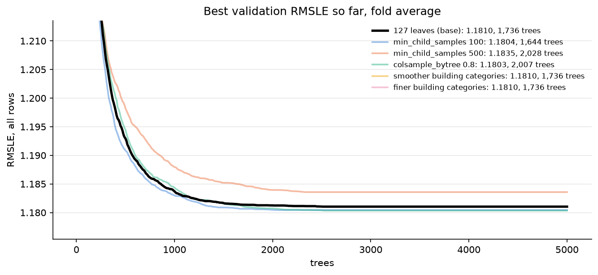

# Baseline report

LightGBM (`LGBMRegressor`) on the 33 shared features. Both models share two settings found in the first experiments:

- `building_id` as a categorical feature ([exp01](experiments/exp01_building.md))
- 2M training rows per fit ([exp02](experiments/exp02_training_rows.md))

Model parameters; everything not listed is the LightGBM default:

| Parameter | Baseline | Tuned |
| --- | --- | --- |
| `num_leaves` | 63 | 127 |
| `n_estimators` | 500 | 1,736 |
| `learning_rate` | 0.1 | 0.1 |
| Fold-average RMSLE, all rows | 1.217 | 1.181 |

## Building

Knowing the building lowers RMSLE by 0.063 on all rows (1.280 to 1.217) and 0.086 on clean rows, in every fold, most on chilled water and steam. lgbm_building is the baseline from here on. [exp01](experiments/exp01_building.md)

## Training rows

More rows barely help: 0.5M to 14M gains 0.010, about the noise level, and 2M to 14M only 0.004 for 3.5 times the training time. Tuning uses 2M rows. [exp02](experiments/exp02_training_rows.md)

## Tree size

With early stopping, 31 to 255 leaves finish within 0.008 (1.180 to 1.188); bigger trees just need fewer of them. 127 leaves is kept: about as good as the best, with a reasonable 1,736 trees. [exp03](experiments/exp03_tree_size.md)

## Regularization

None of five regularizations changes RMSLE by more than 0.003 against plain 127 leaves (1.181). Regularization does not help. [exp04](experiments/exp04_regularization.md)

## Tuned

Tuned lgbm_building (127 leaves, 1,736 trees) lowers RMSLE by 0.036, from 1.217 to 1.181, in every fold and meter, for about 6 times the training time (59 s against 10 s per fit). The gain is slightly optimistic, since the settings were chosen on the same folds. [exp05](experiments/exp05_tuned.md)

## Submission

All models trained on 2M rows from all of 2016, anomalies dropped, seed 0 ([submission_untuned.ipynb](notebooks/submissions/submission_untuned.ipynb), [submission_tuned.ipynb](notebooks/submissions/submission_tuned.ipynb), [submission_31_leaves.ipynb](notebooks/submissions/submission_31_leaves.ipynb)):

| Submission | Local validation | Public | Private |
| --- | --- | --- | --- |
| lgbm_building | 1.217 | 1.110 | 1.318 |
| lgbm_building tuned | 1.181 | 1.097 | 1.325 |
| lgbm_building, 31 leaves, 1,000 trees | 1.218 | 1.112 | 1.317 |

The tuned model slightly overfits: it gains 0.036 locally and 0.013 on public, but loses 0.007 on private. Its settings were chosen on the same 2016 folds they were scored on, and bigger trees fit 2016 more closely without carrying over to the 2017–2018 test years.

31 leaves with 1,000 trees has the same train-validation gap as the baseline ([exp06](experiments/exp06_train_gap.md)) and matches it locally, on public and on private (within 0.002). Shallower trees at the same gap carry over to the test years no better. [exp07](experiments/exp07_31_leaves.md)

## Conclusion

Initial untuned guess from LLM was lucky. Keep it as baseline.