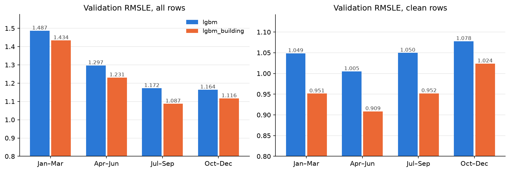

# Experiment 01: lgbm vs lgbm_building

## Question

Does LightGBM improve when it knows which building a row comes from, and by how much?

## Setup

- **Notebook:** [exp01_building.ipynb](../notebooks/experiments/exp01_building.ipynb)
- **MLflow experiment:** `ashrae-baseline-building`, session `2026-10-11 11:16:15`, 8 runs named `<model> | <fold>`; all numbers below are read from these runs
- **Model and parameters:** `LGBMRegressor`, 500 trees, learning rate 0.1, 63 leaves, everything else default
- **Features:** the 33 shared features from [ashrae/features.py](../../ashrae/features.py); lgbm_building adds `building_id` as a categorical
- **Data:** 4 seasonal folds of 2016, 2M training / 500K validation rows per fold, anomalies dropped from training only
- **Seed:** 0, one per run

## Description

Two models on the same rows of each fold. The only difference is the `building_id` feature.

## Parameter tuning log

None; parameters are fixed.

## Results

| Model | Jan–Mar | Apr–Jun | Jul–Sep | Oct–Dec | Average, all rows | Average, clean rows | Training |
| --- | --- | --- | --- | --- | --- | --- | --- |
| lgbm | 1.487 | 1.297 | 1.172 | 1.164 | 1.280 | 1.045 | 0.916 |
| lgbm_building | 1.434 | 1.231 | 1.087 | 1.116 | 1.217 | 0.959 | 0.815 |

| Fold average, all rows | Electricity | Chilled water | Steam | Hot water |
| --- | --- | --- | --- | --- |
| lgbm | 1.019 | 1.501 | 1.647 | 1.625 |
| lgbm_building | 0.975 | 1.392 | 1.560 | 1.583 |

## Conclusion

Yes. The building is worth 0.063 on all rows (0.086 on clean rows), in every fold, most on chilled water and steam. lgbm_building is the baseline from here on.
