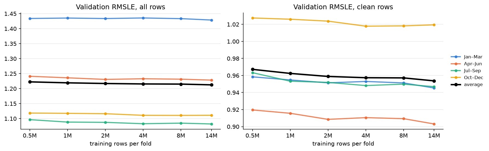

# Experiment 02: Training rows

## Question

Does lgbm_building get better with more training rows?

## Setup

- **Notebook:** [exp02_training_rows.ipynb](../notebooks/experiments/exp02_training_rows.ipynb)
- **MLflow experiment:** `ashrae-baseline-training-rows`, session `2026-10-11 11:28:52`, 24 runs named `lgbm_building | <rows> | <fold>`; all numbers below are read from these runs
- **Model and parameters:** lgbm_building from [exp01](exp01_building.md): `LGBMRegressor`, 500 trees, learning rate 0.1, 63 leaves, everything else default
- **Features:** the 33 shared features from [ashrae/features.py](../../ashrae/features.py) plus `building_id` as a categorical
- **Data:** 4 seasonal folds of 2016, 500K validation rows per fold (the same for every size), anomalies dropped from training only
- **Seed:** 0, one per run

## Description

Training rows per fold: 0.5M, 1M, 2M, 4M, 8M, 14M, sampled from the ~14.5M clean rows outside each validation block. Everything else stays fixed.

## Parameter tuning log

None; parameters are fixed.

## Results

| Training rows | Jan–Mar | Apr–Jun | Jul–Sep | Oct–Dec | Average, all rows | Average, clean rows | Training | Seconds per fit |
| --- | --- | --- | --- | --- | --- | --- | --- | --- |
| 0.5M | 1.434 | 1.241 | 1.097 | 1.118 | 1.223 | 0.967 | 0.801 | 8 |
| 1M | 1.435 | 1.236 | 1.088 | 1.118 | 1.219 | 0.962 | 0.811 | 9 |
| 2M | 1.434 | 1.231 | 1.087 | 1.116 | 1.217 | 0.959 | 0.815 | 10 |
| 4M | 1.436 | 1.233 | 1.083 | 1.111 | 1.216 | 0.957 | 0.818 | 13 |
| 8M | 1.433 | 1.231 | 1.085 | 1.111 | 1.215 | 0.957 | 0.820 | 24 |
| 14M | 1.429 | 1.228 | 1.082 | 1.111 | 1.213 | 0.954 | 0.819 | 35 |

| Fold average, all rows | Electricity | Chilled water | Steam | Hot water |
| --- | --- | --- | --- | --- |
| 0.5M | 0.975 | 1.409 | 1.566 | 1.592 |
| 2M | 0.975 | 1.392 | 1.560 | 1.583 |
| 14M | 0.974 | 1.384 | 1.552 | 1.579 |

## Conclusion

No, not meaningfully. 0.5M → 14M gains 0.010 (clean rows 0.013), about the noise level, and 2M → 14M only 0.004, for 3.5× the training time. Data size isn't what limits lgbm_building. Keep 2M rows for the next baseline experiments; the final model can use all rows, since one fit at 14M takes 35 s.
