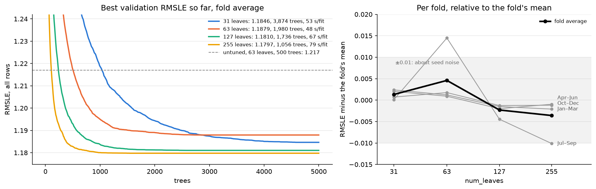

# Experiment 03: Tree size

## Request

Experiment 03 looks too big for me. Suggest how to split it, without losing MLflow results

## Question

How does fold-average validation RMSLE of lgbm_building, with an early-stopped tree count, change across num_leaves 31, 63, 127 and 255?

## Plan

Each leaf count trains on all 4 folds with up to 5,000 trees; a fold stops after 200 trees without improvement, and the trial's tree count is the mean of the folds' best tree counts. This stage ran before exp03 was split into exp03 to exp05 (16 runs), so the notebook reads that pinned MLflow session by default (`TRAIN = False`) and nothing is retrained.

## Setup

- **Notebook:** [exp03_tree_size.ipynb](../notebooks/experiments/exp03_tree_size.ipynb)
- **Tracking:** MLflow `ashrae-baseline-tuning`, session `2026-10-11 12:25:43`, tag `stage = A` (16 runs)
- **What changes:** `num_leaves` 31, 63, 127, 255
- **What stays fixed:** lgbm_building (33 shared features plus `building_id` as a categorical), learning rate 0.1, 2M training and 500K validation rows per fold, 4 seasonal folds of 2016, anomalies dropped from training only, seed 0
- **Metric:** validation RMSLE at each fold's best tree, all rows and clean rows, averaged over folds; tree count and seconds per fit

## Results

Validation RMSLE, all rows (500K per fold): left, best so far by tree count, fold average; right, each fold relative to its mean over the four sizes. The dashed line is untuned lgbm_building (63 leaves, 500 trees).

## AI Summary

Tree size barely matters: 31 to 255 leaves finish within 0.008 (1.180 to 1.188), inside seed noise, with 255 leaves best by a hair. Bigger trees just get there in fewer trees (1,056 at 255 leaves, 3,874 at 31).

## Conclusion

Keep 127 as it slightly outperforms the rest while using reasonable number of trees (1736).

