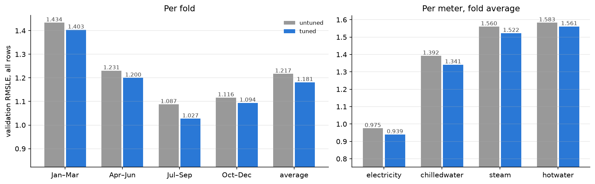

# Experiment 05: Tuned lgbm_building

## Request

Experiment 03 looks too big for me. Suggest how to split it, without losing MLflow results.

## Question

How much does tuned lgbm_building lower fold-average validation RMSLE against its untuned settings (500 trees, 63 leaves; 1.217 in [exp01](exp01_building.md))?

## Plan

Tuned is plain 127 leaves from [exp03](exp03_tree_size.md), since [exp04](exp04_regularization.md) found no regularization helps. Retrain it on the 4 folds with its trial tree count and no early stopping, and score it like exp01. The settings were chosen on the same folds they are scored on, so the tuned score is slightly optimistic. Only this retrain is new; the build is checked in smoke mode and you run it at full scale.

## Setup

- **Notebook:** [exp05_tuned.ipynb](../notebooks/experiments/exp05_tuned.ipynb)
- **Tracking:** MLflow `ashrae-baseline-tuning`, new runs `lgbm_building_tuned | <fold>` with tag `stage = final`; untuned runs from `ashrae-baseline-building`
- **What changes:** untuned against tuned settings (127 leaves and tree count from exp03)
- **What stays fixed:** features, learning rate 0.1, 2M training and 500K validation rows per fold, 4 seasonal folds, seed 0
- **Metric:** validation RMSLE per fold and averaged, all rows, clean rows and per meter; training RMSLE; seconds per fit

## Results

Validation RMSLE, all rows (500K per fold); tuned is 127 leaves, 1,736 trees.

## AI Summary

Tuning lowers fold-average RMSLE by 0.036, from 1.217 to 1.181, and every fold and meter improves; the gain is slightly optimistic, since the settings were chosen on these folds. It costs about 6 times the training time (59 s against 10 s per fit).

## Conclusion

[human]
