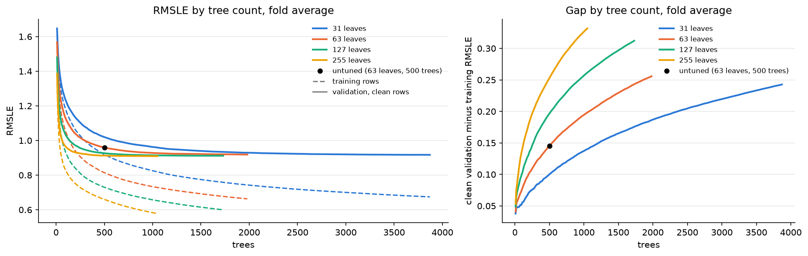

# Experiment 06: Training against validation by tree size

## Request

Check the train validation gap for tuning.

## Question

How does the gap between training RMSLE and clean-row validation RMSLE change across num_leaves 31, 63, 127 and 255, at each one's exp03 tree count?

## Plan

Retrain each leaf count from [exp03](exp03_tree_size.md) on the 4 folds with its exp03 tree count (31: 3,874, 63: 1,980, 127: 1,736, 255: 1,056) and no early stopping, scoring every tree on a 500K subsample of the training rows as well as on validation. The validation curves should match exp03's exactly, and the 63 leaves curve at tree 500 is untuned lgbm_building.

## Setup

- **Notebook:** [exp06_train_gap.ipynb](../notebooks/experiments/exp06_train_gap.ipynb)
- **Tracking:** MLflow `ashrae-baseline-tuning`, new runs `<leaves> leaves | <fold>` with tag `stage = gap`; tree counts read from exp03's session `2026-10-11 12:25:43`, `stage = A`
- **What changes:** `num_leaves` 31, 63, 127, 255, each with its exp03 tree count
- **What stays fixed:** everything in exp03: lgbm_building, learning rate 0.1, 2M training and 500K validation rows per fold, 4 seasonal folds, seed 0
- **Metric:** RMSLE by tree count on training rows (500K subsample), validation all rows and validation clean rows, averaged over folds; gap = clean validation minus training at the final tree

## Results

RMSLE averaged over the 4 seasonal folds; training on a 500K subsample of each fold's 2M training rows, validation on the clean rows of each fold's 500K validation rows. Left: both curves by tree count; right: their gap (clean validation minus training) by tree count. Retrained validation curves match exp03 exactly (max difference 0).

## AI Summary

The gap grows with tree size, from 0.24 at 31 leaves and 0.26 at 63 to 0.31 at 127 and 0.33 at 255, because training RMSLE drops (0.67 → 0.58) much more than clean validation does (0.917 → 0.910). Bigger trees fit the training rows harder for only a small validation gain.

## Conclusion

Higher number of trees leads to overfitting, bigger lead to faster gap growth. Reasonable candidate to try is 31 leafs on 1000 trees, because it poentially simplier mode that can lead to better generalization.
