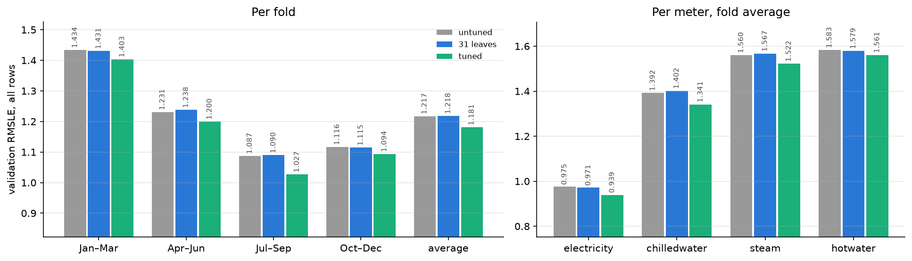

# Experiment 07: 31 leaves against untuned and tuned

## Request

compare 31 leaves model with baseline and tuned version based on val rmsle

## Question

How does fold-average validation RMSLE of lgbm_building with 31 leaves and 1,000 trees compare with untuned (63 leaves, 500 trees; 1.217 in [exp01](exp01_building.md)) and tuned (127 leaves, 1,736 trees; 1.181 in [exp05](exp05_tuned.md))?

## Plan

The 31 leaves, 1,000 trees setting is the one [exp06](exp06_train_gap.md) found with the same gap as untuned (about 0.14). Retrain it on the 4 folds with no early stopping and score it like exp05: all rows, clean rows, per meter and training rows. Untuned and tuned are read from MLflow, not retrained. As a check, its validation RMSLE should match the exp06 31 leaves curve at tree 1,000. The build is checked in smoke mode and you run it at full scale (4 fits, about 15 s each).

## Setup

- **Notebook:** [exp07_31_leaves.ipynb](../notebooks/experiments/exp07_31_leaves.ipynb)
- **Tracking:** MLflow `ashrae-baseline-31_leaves`, new runs `lgbm_building_31_leaves | <fold>` with tag `stage = 31_leaves`; untuned from `ashrae-baseline-building` (`lgbm_building | <fold>`), tuned from `ashrae-baseline-tuned` (`stage = final`), the exp06 check from `ashrae-baseline-train_gap` with 1,736 trees
- **What changes:** 31 leaves, 1,000 trees against untuned and tuned
- **What stays fixed:** features, learning rate 0.1, 2M training and 500K validation rows per fold, 4 seasonal folds, anomalies dropped from training only, seed 0
- **Metric:** validation RMSLE per fold and averaged, all rows, clean rows and per meter; training RMSLE; seconds per fit

## Results

Validation RMSLE, all rows (500K per fold); 31 leaves, 1,000 trees matches the exp06 curve at tree 1,000 exactly on every fold.

## AI Summary

31 leaves with 1,000 trees scores the same as untuned (1.218 against 1.217, every fold and meter within 0.01), while tuned stays 0.036 lower on every fold and meter. On 2016 folds the shallower trees buy nothing at the same gap, and they cost 13 s per fit against 10 s.

## Conclusion

The difference between 31 leaves and untuned lgbm is ~0.001, which is noise.
