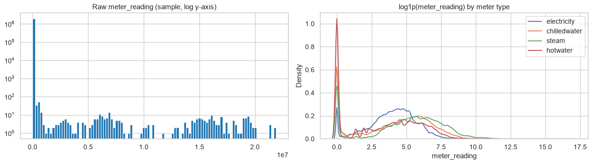
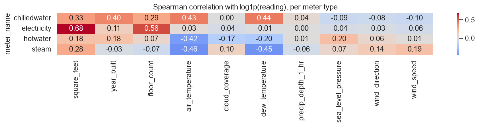
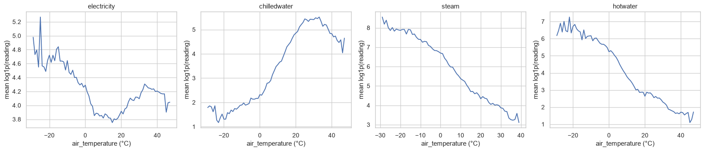
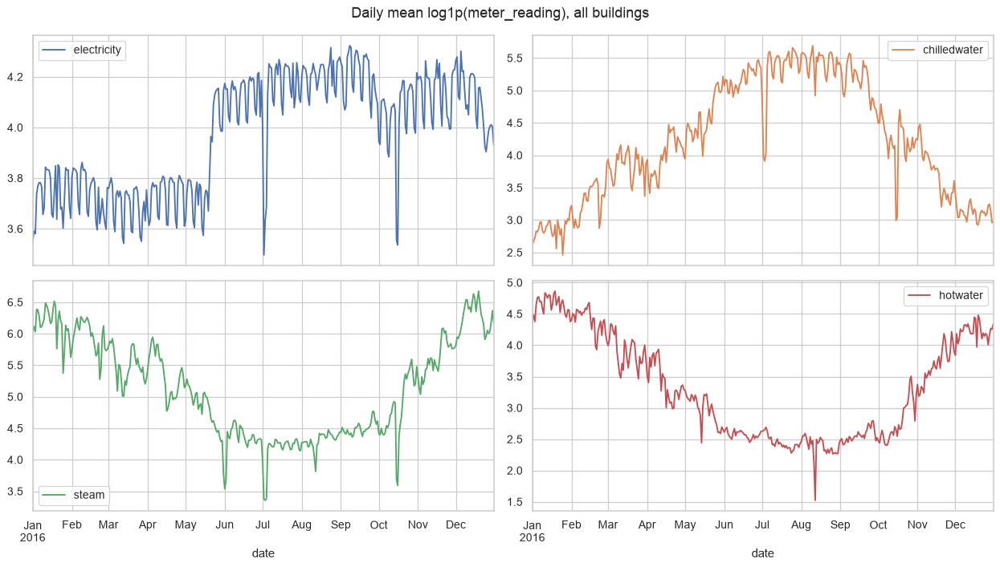
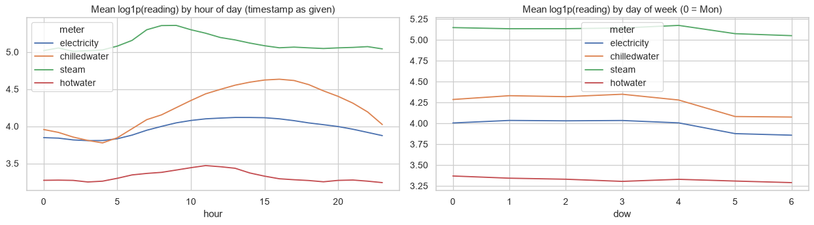
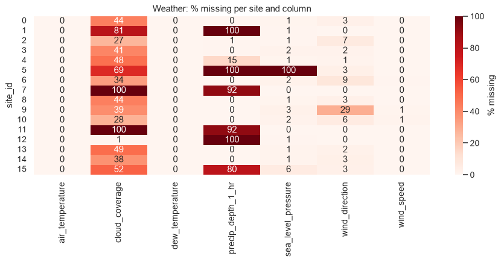
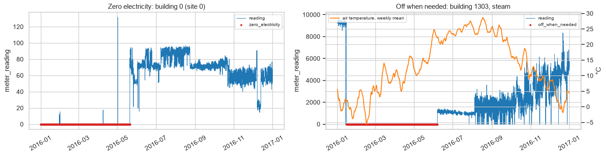
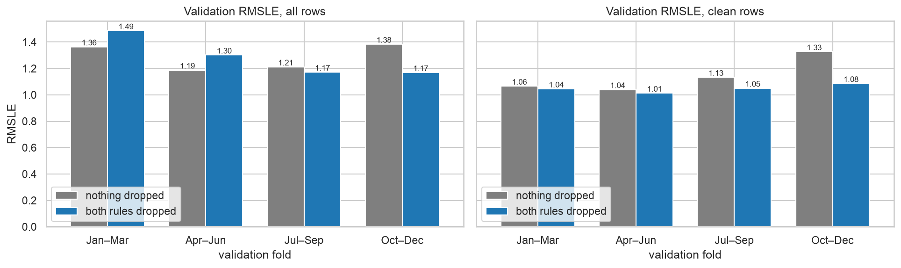
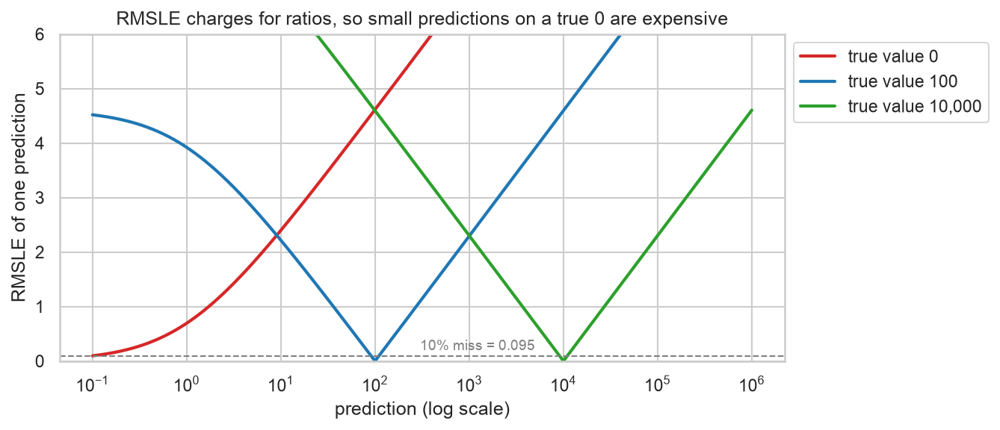

# EDA and Preprocessing

The analysis is split into four experiment cards: [exp01_overview](experiments/exp01_overview.md) profiles the raw tables, [exp02_time_zones](experiments/exp02_time_zones.md) looks at time patterns and the clock mismatch between weather and meters, [exp03_metric](experiments/exp03_metric.md) studies RMSLE, and [exp04_anomalies](experiments/exp04_anomalies.md) tests which broken-meter rows to drop. [data_aggregation.ipynb](notebooks/data_aggregation.ipynb) applies the decisions and builds the training and test tables. Every section below states a finding, shows the figure it rests on, and ends with what it changed in the pipeline.

## The data

The training set covers 2016 hourly: 20.2M readings from 2,380 building × meter series, 1,449 buildings at 16 sites. Most buildings are simple. 875 of them have a single meter, almost always electricity, and electricity makes up 60% of all rows. We therefore keep one row per building × meter × hour instead of a column per meter type, which would be mostly empty. The tables are clean in the structural sense: there are no duplicate keys, and the weather is missing at most 330 hours at any site.

## The target

`meter_reading` is extremely skewed. A single steam meter, building 1099, accounts for 78% of all energy in the training set, and the raw histogram is a spike at zero with a long tail up to 2·10⁷. On a `log1p` scale each meter type becomes a single hump around 4 to 6, plus a separate peak at exactly zero.

That zero peak is large: 27% of hot water readings, 16% of chilled water, 13% of steam and 4% of electricity are zero. Some are real (heating is off in summer), but a building never uses no electricity at all, so many zeros are outages, which is the subject of [the anomaly section](#broken-meters).

We predict `log1p(meter_reading)` with MSE loss. Since RMSLE is RMSE on `log1p` values, the loss is the competition metric ([exp03_metric](experiments/exp03_metric.md)). Predictions are clipped at 0 ([mlp/src/predict.py](../mlp/src/predict.py)). Site 0 electricity is reported in kBTU, not kWh, so it is converted for training and converted back for the submission ([data_aggregation.ipynb §1](notebooks/data_aggregation.ipynb)).

## What drives consumption

Floor area is the strongest building feature, with Spearman ρ = 0.68 against electricity, and it is bell-shaped on a log scale, so it enters the model as `log1p(square_feet)`. Weather matters through temperature, but in opposite directions: chilled water rises with temperature (ρ = 0.43) while steam and hot water fall (ρ ≈ −0.45). Precipitation and cloud coverage are nearly unrelated to any meter, with |ρ| of at most 0.17.

Correlation hides the shape, so we also plotted the mean reading against air temperature. Steam and hot water fall almost linearly from −30 °C to 40 °C, chilled water climbs steeply from about 0 °C and peaks around 30 °C, and electricity is U-shaped, with its minimum around 10 °C. A model has to combine meter type with weather, since the same temperature means opposite things for heating and cooling.

The same split shows up over the year. Chilled water peaks in July and August, while steam and hot water peak in winter. Electricity is flat across seasons apart from a step at the end of May, which coincides with site 0's electricity meters starting to report after months of zeros (building 0 in the [anomaly figure](#broken-meters) is one of them). The weekly ripple in every series is the weekend dip.

Within a day, use rises in the morning and falls at night, and Saturday and Sunday are lower than weekdays for electricity and chilled water. This is why the model gets hour of day and day of week as sin/cos features, computed in local time.

## Missing values

Missing data is concentrated in a few columns and comes site by site rather than at random. `floor_count` is missing for 76% of buildings (83% of rows) and `year_built` for 53% of buildings (60% of rows), and in both cases whole sites report nothing. In the weather, cloud coverage is missing in 49% of rows and precipitation in 36%, and the heatmap shows that sites 1, 5, 7, 11 and 12 never report one or the other, while site 5 also never reports sea level pressure.

Because cloud coverage and precipitation are both sparse and barely related to the target, they are dropped, and so is `floor_count`. `year_built` is kept, filled with the training median plus a "missing" flag ([data_aggregation.ipynb §3](notebooks/data_aggregation.ipynb)). The remaining weather columns (air and dew temperature, sea level pressure) are interpolated linearly in time within each site. A site that never reports a column gets the mean of the other sites at the same hour. Wind direction is turned into sin and cos before interpolation, so that 359° and 1° do not average to 180° ([data_aggregation.ipynb §2](notebooks/data_aggregation.ipynb), [eda/src/raw_data.py](src/raw_data.py)).

## Time zones

As noted on the [competition forum](https://www.kaggle.com/c/ashrae-energy-prediction/discussion/115698), weather timestamps are in UTC while meter timestamps are local. Our data confirms it. With raw timestamps, temperature peaks at 13:00–15:00 at the UTC±0 sites but around 20:00 at the American sites, which is impossible for local afternoon heat. After shifting each site by its UTC offset, temperature peaks at 14:00–16:00 everywhere. Electricity, plotted with its raw timestamps, already peaks during the working day, which shows the meters are on local time.

Site 14 is the exception. Its electricity profile lines up with the other sites only after a +5 h shift, exactly its offset (correlation 0.24 → 0.99), so its meters are in UTC as well and its weather is left unshifted. With this fix the LightGBM baseline goes from 1.290 to 1.286 averaged over the four seasonal folds, and no fold gets worse ([exp04_anomalies](experiments/exp04_anomalies.md)).

## Broken meters

Our cleaning follows three prior write-ups: the data-cleaning approach of a top ASHRAE solution ([1](../README.md#references)), the anomaly-correction approach of a BirdCLEF solution ([2](../README.md#references)), and identifying sites and buildings by internet search ([3](../README.md#references)).

Some series are plainly broken. Building 0 reports zero electricity from January to late May and then a normal load of 60–90 kWh. Building 1303 reports zero steam from mid-January to June, through the coldest weeks of the year, which a heated building cannot do.

From this we drop two kinds of training rows. The first is every zero electricity reading. The second is "off when needed": steam or hot water at zero for a week or more while that week averages below 10 °C, or chilled water at zero for a week or more above 20 °C. Together that is 599,086 rows, 3.0% of the training data ([data_aggregation.ipynb §4](notebooks/data_aggregation.ipynb)). The rows are dropped from training only. Validation keeps them, because the Kaggle test set contains broken meters as well.

The effect depends on what we score. On clean validation rows dropping anomalies helps in every fold, and the four-fold average falls from 1.140 to 1.048. On all rows, which is how Kaggle scores, the average barely moves (1.286 → 1.281): Jul–Sep and Oct–Dec improve, but Jan–Mar and Apr–Jun get worse. In those folds the broken meters are still broken during the validation months, so a model that has learned a meter's zeros wins. Scoring only Oct–Dec (1.383 → 1.168) would have overstated the gain. We keep the drop, because it makes the model learn real consumption, and anomaly rows that stay in validation cost up to 0.48 RMSLE per fold ([exp02_seasons](../validation/experiments/exp02_seasons.md)).

Shorter cut-offs for the electricity rule worked better than longer ones: dropping only zero runs of 720+ hours gives 1.095 on clean rows, against 1.061 for dropping every zero, since even a few hours of zeros teach the model that a building can use no power. Two further rules did not help. Stuck meters (the same non-zero value for 48+ hours) and spikes (more than 10× the series' daily median) change the four-fold average by at most 0.003 on top of the two rules, and the spike rule mostly flagged normal on/off cycling, so both were left out.

Under the seasonal four-fold validation the preprocessing as a whole turned out to be a small change, although the earlier hold-out validation had made it look like a big boost ([exp02_building](../mlp/experiments/exp02_building.md)).

## The metric

RMSLE measures relative error. A 10% miss costs about 0.095 whether the true value is 100 or 10,000, so the few huge series do not dominate the score, which is what the competition wants. In the plot below each true value gives the same V shape on a log axis, just moved sideways.

The weakness is near zero. The red curve has no room to the left: predicting 5 for a true 0 costs 1.79, nineteen times a 10% miss. Since many zeros are broken meters, part of the score is really about guessing outages. RMSLE also ignores whether errors cancel out over a day or a year, is undefined for negative predictions (hence the clip at 0), and turns a unit mix-up such as site 0's kBTU into a large constant error.

To see past these effects we track three more numbers next to the score. RMSLE on clean rows shows the error on real consumption ([exp02_seasons](../validation/experiments/exp02_seasons.md)). RMSLE per meter type matters because electricity and hot water differ by 0.6 ([exp01_outputs](../mlp/experiments/exp01_outputs.md)). The spread across the four folds sets the bar for changes: a change has to help in at least three of four seasons. For ensembles we also look at the residual correlation between models, which bounds what blending can gain.

A better-suited target metric would be CV(RMSE) per building × meter series, averaged over series. The competition is about estimating energy savings after retrofits, which needs errors in kWh, and ASHRAE Guideline 14 uses CV(RMSE) for exactly this. Averaging per series keeps big buildings from dominating, and zeros do not blow it up. We have not computed it for our models.

## Model inputs

Training, validation and test get the same features from [ashrae/features.py](../ashrae/features.py): `log1p(square_feet)`, `year_built` with its missing flag, air and dew temperature, sea level pressure, wind speed, wind direction as sin/cos, hour of day and day of week as sin/cos in local time, and one-hot `meter` and `primary_use`. Building identity enters either as a learned 16-number embedding per building or as the mean `log1p` reading of each building × meter series ([exp02_building](../mlp/experiments/exp02_building.md)).
