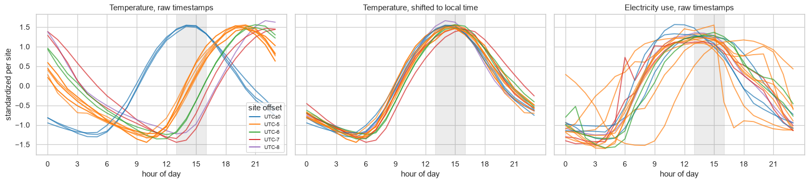

# Experiment 02: Temporal patterns and time zones

## Request

Not recorded; converted from `eda/notebooks/EDA.ipynb` section 6. The suspicion came from a [Kaggle discussion](https://www.kaggle.com/c/ashrae-energy-prediction/discussion/115698).

## Question

Are weather timestamps in UTC while meter timestamps are local, judged by the hour at which each site's temperature and electricity use peak?

## Plan

Plot daily, hourly and weekday profiles of `log1p(meter_reading)` per meter type. Then compare per-site hourly profiles: temperature with raw timestamps, temperature shifted by the site's UTC offset, and electricity with raw timestamps. For each site, find the hour shift that best lines up its electricity profile with the average of the other sites.

## Setup

- **Notebook:** [exp02_time_zones.ipynb](../notebooks/experiments/exp02_time_zones.ipynb)
- **Tracking:** none
- **What changes:** weather timestamps raw or shifted by the site's UTC offset (`UTC_OFFSET` in [eda/src/raw_data.py](../src/raw_data.py)); hour shift of each site's electricity profile, -12 to 11 h
- **What stays fixed:** all 2016 training readings; electricity profiles use positive readings relative to each building's mean; every profile standardized per site
- **Metric:** hour of the temperature peak per site; correlation of a site's electricity profile with the other sites' average, unshifted and at the best shift

## Results

Hourly profiles standardized per site, all 2016 training rows. Electricity alignment: site 14 is best at +5 h (correlation 0.24 to 0.99), every other site within 3 h.

## AI Summary

Yes: shifted to local time, temperature peaks at 14:00 to 16:00 at every site, and unshifted electricity already peaks in the working day at 15 of 16 sites. Site 14 needs +5 h, exactly its offset, so its meters are in UTC too; the fix is worth 1.290 to 1.286 for LightGBM ([exp04_anomalies](exp04_anomalies.md)).

## Conclusion

[human]
