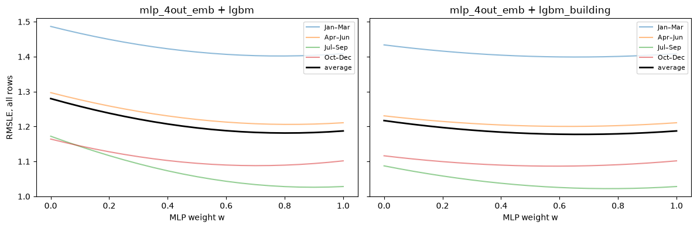

# Experiment 01: Blend of mlp_4out_emb_bn and LightGBM

## Request

Not recorded; converted from `ensemble/notebooks/ensemble.ipynb` (runs of 2026-09-27).

## Question

Does a weighted `log1p` blend of mlp_4out_emb_bn with LightGBM, its weight chosen leave-one-fold-out, lower fold-average validation RMSLE below the MLP alone?

## Plan

On each fold, train the MLP and two LightGBMs on the same rows and keep their validation predictions. Blend them as `w · mlp + (1 - w) · lgbm` in `log1p` space, choosing `w` on the other three folds, so the blend is scored on rows its weight never saw. Check residual correlation and per-meter scores, then repeat the best pair with 4M training rows.

## Setup

- **Notebook:** [exp01_blend.ipynb](../notebooks/experiments/exp01_blend.ipynb)
- **Tracking:** MLflow `ashrae-ensemble-blend`, session `2026-09-27 21:29:11`, 8 MLP runs named `mlp_4out_emb_bn | <rows> rows | <fold>`, tag `notebook = exp01_blend`; LightGBM is not logged
- **What changes:** second model: lgbm, or lgbm_building (plus `building_id` as a categorical); MLP weight 0 to 1 in steps of 0.05; training rows 2M or 4M
- **What stays fixed:** mlp_4out_emb_bn, Adam, 20 epochs ([mlp exp15_epochs](../../mlp/experiments/exp15_epochs.md)); LightGBM untuned (500 trees, learning rate 0.1, 63 leaves, one thread); the same 33 features; 500K validation rows per fold; seed 0
- **Metric:** validation RMSLE per fold and averaged, on all rows and clean rows; residual correlation on clean rows

## Results

| Model | All rows | Clean rows |
| --- | --- | --- |
| mlp_4out_emb_bn | 1.187 | 0.924 |
| lgbm | 1.280 | 1.045 |
| lgbm_building | 1.217 | 0.959 |
| blend with lgbm | 1.183 | 0.919 |
| blend with lgbm_building | 1.178 | 0.911 |

Fold-average validation RMSLE, 500K validation rows per fold, blends at the weight chosen on the other three folds (0.6 to 0.7 for lgbm_building). With 4M training rows: mlp_4out_emb_bn 1.186, lgbm_building 1.216, blend 1.176.

## AI Summary

Yes, slightly: blending with lgbm_building gives 1.178 against 1.187, better in all 4 folds, with a stable weight; the gain is small because the residuals correlate at 0.88. It helps heating and cooling, not electricity, and doubling the training rows changes nothing.

## Conclusion

[human]
