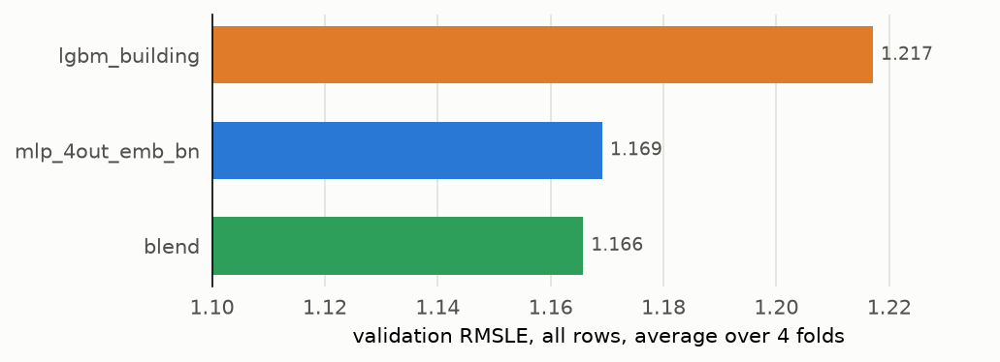

# Experiment 01: Blend of the final MLP and lgbm_building

## Request

remake ensemble experiment: train ensemble for mlp_4out_emb_nb (or take it from MLFLow if you can), and compare with pure lgbm_building and mlp_4out_emb_nb

## Question

Does a weighted `log1p` blend of the final MLP with lgbm_building, its weight chosen leave-one-fold-out, lower fold-average validation RMSLE more than 0.01 below the final MLP alone?

## Plan

On each fold, train the final MLP and lgbm_building on the same rows and keep their validation predictions. Blend them as `w · mlp + (1 - w) · lgbm` in `log1p` space for `w` from 0 to 1 in steps of 0.05, choosing `w` on the other three folds, so the blend is scored on rows its weight never saw. The figure compares fold-average validation RMSLE of lgbm_building, the final MLP and the blend.

## Setup

- **Notebook:** [exp01_final_blend.ipynb](../notebooks/experiments/exp01_final_blend.ipynb)
- **Tracking:** MLflow `ashrae-ensemble-final-blend`, session `2026-10-13 12:40:27`, 12 runs named `<mlp_4out_emb_bn | lgbm_building | blend> | <fold>`, tag `notebook = exp02_final_blend` (logged before the renumbering); MLflow holds only metrics from [mlp exp17](../../mlp/experiments/exp17_lr_schedule.md) and [baseline exp01](../../baseline/experiments/exp01_building.md), not predictions, so both models are retrained
- **What changes:** model: final MLP, lgbm_building, or their blend; MLP weight 0 to 1 in steps of 0.05
- **What stays fixed:** final MLP as in [mlp exp18](../../mlp/experiments/exp18_final_comparison.md) (mlp_4out_emb, emb_dim 12, 2 hidden layers of 64, BatchNorm, dropout 0.1, Adam lr 1e-2 divided by 10 at epochs 20 and 30, batch 4096, 40 epochs, scored at the last epoch); lgbm_building as in baseline exp01; features from [ashrae/features.py](../../ashrae/features.py), 2M training / 500K validation rows per fold, anomalies dropped from training only, seed 0
- **Metric:** validation RMSLE on all rows, averaged over the 4 folds; the MLP at epoch 40

## Results

Validation RMSLE on all rows (500K per fold), averaged over the 4 folds; the blend at the MLP weight chosen on the other three folds (0.75 to 0.8).

## AI Summary

No: the blend scores 1.166, only 0.003 below the final MLP (1.169), well short of the 0.01 margin, though both clearly beat lgbm_building (1.217). The tuned MLP leaves little for LightGBM to add, so the blend leans on it with a weight of about 0.8.

## Conclusion
