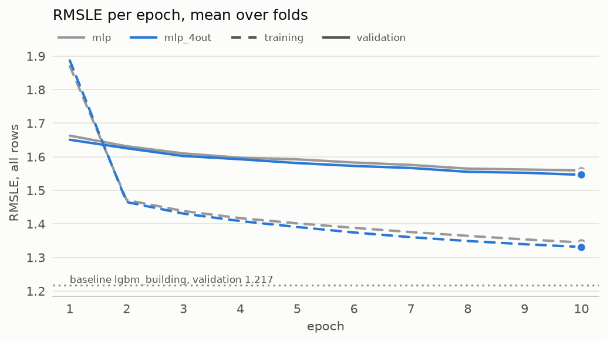

# Experiment 01: One output per meter type

## Request

split experiment 1: 1st experiment is comparison of 2 layer MLP and MLP 4out

Split from the former exp01_buildup (runs of 2026-09-27).

## Question

Does one output per meter type (mlp_4out) lower fold-average validation RMSLE against a plain 2-layer MLP (mlp, 1.559), on at least 3 of 4 folds?

## Plan

Train both networks for 10 epochs on the 4 seasonal folds and compare validation RMSLE per fold, overall and per meter type.

## Setup

- **Notebook:** [exp01_outputs.ipynb](../notebooks/experiments/exp01_outputs.ipynb)
- **Tracking:** MLflow `ashrae-mlp-outputs`, session 2026-10-12 10:53:33, 8 runs named `<model> | <fold>`, tag `notebook = exp01_outputs`
- **What changes:** mlp (one output); mlp_4out (one output per meter type)
- **What stays fixed:** 2 hidden layers of 64, ReLU, Adam (lr 1e-3), batch 4096, 10 epochs, features from [ashrae/features.py](../../ashrae/features.py), 2M training / 500K validation rows per fold, anomalies dropped from training only, seed 0
- **Metric:** validation RMSLE per fold and averaged, all rows, clean rows and per meter; training RMSLE at the last epoch

## Results

| | Jan–Mar | Apr–Jun | Jul–Sep | Oct–Dec | average |
| --- | --- | --- | --- | --- | --- |
| mlp − mlp_4out | 0.021 | 0.010 | 0.013 | 0.008 | 0.013 |

Validation RMSLE, all rows (500K per fold), at epoch 10; the table gives the per-fold gap behind the figure's last points (positive: mlp_4out is better).

## AI Summary

Yes: mlp_4out is ahead on all 4 folds and at every epoch, 1.559 to 1.546 at epoch 10, with the largest gain on hot water (2.009 to 1.972). The gap is small (0.013 on average) and comes from one seed, so it is weak evidence.

## Conclusion

Picking projection from 4out model instead of 1out improved score, but improvement is close to threshhold 0.01.

Keep the 4out model for further tuning. In the end compare 4out vs 1 out again.

Note that both do not beat baseline.