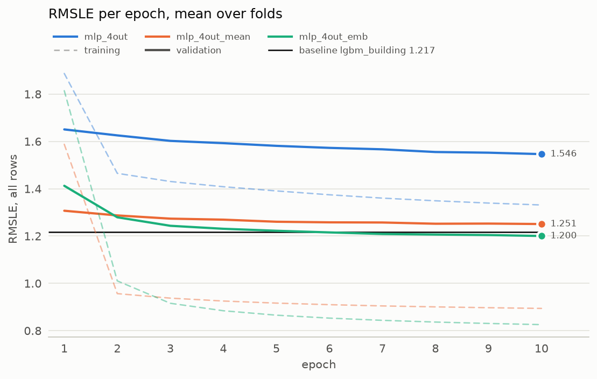

# Experiment 02: Building identity

## Request

2nd is MLP 4out vs MLP 4out emb and MLP 4out mean

Split from the former exp01_buildup (runs of 2026-09-27).

Let me clarify something: here Batch Norm should not be bresent in 4out, means and emb. Rename old records from 4out_emb to 4out_emb_bn, here only without batchnorm. Change plan first

## Question

Does giving mlp_4out the building's identity, as the series mean (mlp_4out_mean) or a learned embedding (mlp_4out_emb), lower fold-average validation RMSLE below mlp_4out (1.546, [exp01](exp01_outputs.md)), and does either beat the baseline lgbm_building (1.217, [baseline exp01](../../baseline/experiments/exp01_building.md))?

## Plan

Train mlp_4out_mean and mlp_4out_emb for 10 epochs on the 4 seasonal folds. mlp_4out is reused from exp01 and the baseline from baseline exp01, so neither is retrained.

## Setup

- **Notebook:** [exp02_building.ipynb](../notebooks/experiments/exp02_building.ipynb)
- **Tracking:** MLflow `ashrae-mlp-building`, session `2026-10-12 12:03:22`, 8 runs named `<model> | <fold>`, tag `notebook = exp02_building`; mlp_4out from `ashrae-mlp-outputs`, session `2026-10-12 10:53:33`; baseline from `ashrae-baseline-building`, session `2026-10-11 11:16:15` (`lgbm_building | <fold>`)
- **What changes:** mlp_4out; mlp_4out_mean (the mean `log1p` reading of each building x meter series as one extra input); mlp_4out_emb (a learned 16-number vector per building)
- **What stays fixed:** 2 hidden layers of 64, ReLU, one output per meter type, Adam (lr 1e-3), batch 4096, 10 epochs, features from [ashrae/features.py](../../ashrae/features.py), 2M training / 500K validation rows per fold, anomalies dropped from training only, seed 0
- **Metric:** validation RMSLE per fold and averaged, all rows, clean rows and per meter; training RMSLE at the last epoch

## Results

| | Jan–Mar | Apr–Jun | Jul–Sep | Oct–Dec | average |
| --- | --- | --- | --- | --- | --- |
| lgbm_building − mlp_4out_emb | 0.014 | 0.008 | 0.034 | 0.011 | 0.017 |

Validation RMSLE, all rows (500K per fold), at epoch 10; the table gives the per-fold gap between the baseline and the best MLP (positive: mlp_4out_emb is better).

## AI Summary

Yes: building identity cuts mlp_4out's 1.546 to 1.251 as the series mean and to 1.200 as an embedding. Only mlp_4out_emb beats lgbm_building (1.217), on all 4 folds but by 0.017 on average from one seed.

## Conclusion

Building id has as much signifficance as earlier. Note that even adding identity with mean improves score signifficantly. Continue with embeding version. In further we can reduce number of dimensions for embedding.  
