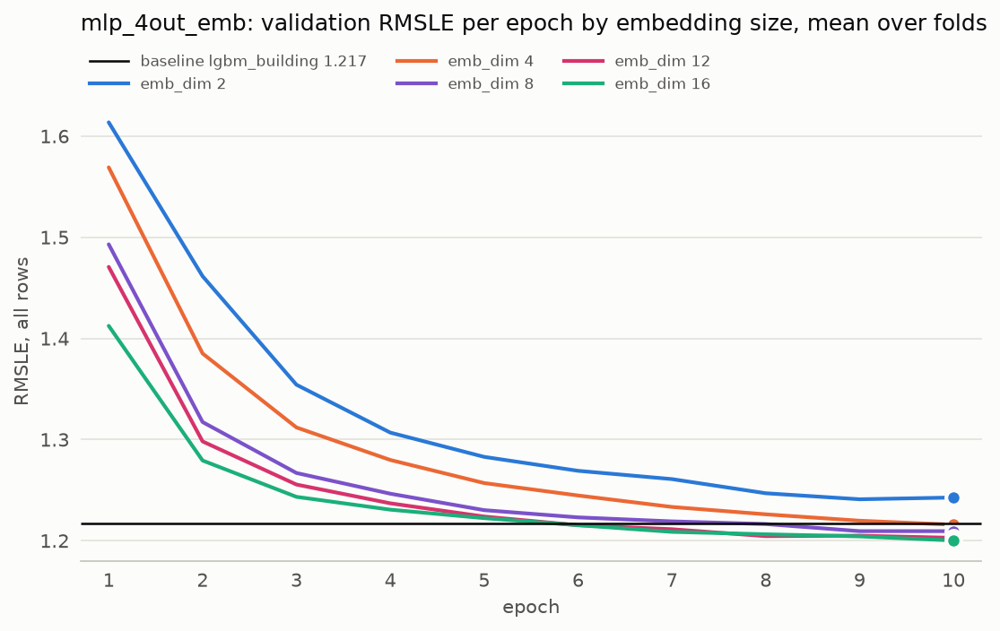

# Experiment 03: Embedding size

## Request

Create new experiment artifact: tune emb_dim parameter for dim = 2,4,8,12,16 for 4out_emb model. It should go after exp02_building, move other experiments forward

## Question

Which building embedding size of mlp_4out_emb, out of 2, 4, 8, 12 and 16, gives the lowest fold-average validation RMSLE, and does any size below 16 match or beat the 1.200 of the 16-number embedding ([exp02](exp02_building.md))?

## Plan

Train mlp_4out_emb with emb_dim 2, 4, 8 and 12 for 10 epochs on the 4 seasonal folds; emb_dim 16 is mlp_4out_emb from exp02 and is reused, not retrained. Plot validation RMSLE per epoch, mean over folds, one colour per size, against the baseline; then compare the per-fold scores at epoch 10 and pick the smallest size within noise of the best.

## Setup

- **Notebook:** [exp03_emb_dim.ipynb](../notebooks/experiments/exp03_emb_dim.ipynb)
- **Tracking:** MLflow `ashrae-mlp-emb-dim`, session `2026-10-12 12:25:17`, 16 runs named `mlp_4out_emb | emb <dim> | <fold>`, tag `notebook = exp03_emb_dim`; emb_dim 16 from `ashrae-mlp-building`, session `2026-10-12 12:03:22` (`mlp_4out_emb | <fold>`); baseline from `ashrae-baseline-building`, session `2026-10-11 11:16:15` (`lgbm_building | <fold>`)
- **What changes:** emb_dim of the building embedding: 2, 4, 8, 12, 16
- **What stays fixed:** mlp_4out_emb, 2 hidden layers of 64, ReLU, one output per meter type, Adam (lr 1e-3), batch 4096, 10 epochs, features from [ashrae/features.py](../../ashrae/features.py), 2M training / 500K validation rows per fold, anomalies dropped from training only, seed 0
- **Metric:** validation RMSLE per fold and averaged, all rows and clean rows; validation RMSLE per epoch, mean over folds; training RMSLE at the last epoch

## Results

| emb_dim | Jan–Mar | Apr–Jun | Jul–Sep | Oct–Dec | average | average, clean rows | training |
| --- | --- | --- | --- | --- | --- | --- | --- |
| 2 | 1.466 | 1.254 | 1.117 | 1.134 | 1.243 | 0.993 | 0.891 |
| 4 | 1.440 | 1.227 | 1.085 | 1.111 | 1.216 | 0.964 | 0.861 |
| 8 | 1.434 | 1.226 | 1.069 | 1.108 | 1.209 | 0.946 | 0.839 |
| 12 | 1.421 | 1.231 | 1.056 | 1.103 | 1.203 | 0.941 | 0.830 |
| 16 | 1.420 | 1.223 | 1.053 | 1.105 | 1.200 | 0.934 | 0.826 |

Validation RMSLE at epoch 10, all rows (500K per fold) unless noted, per fold and mean over the 4 folds; training RMSLE at the last epoch; baseline lgbm_building 1.217.

## AI Summary

16 stays the best (1.200), but from 8 upward every size is within the 0.01 threshold, with 8 only just inside it (1.209) and 12 comfortably so (1.203). Since the private leaderboard also scores messy targets, the simpler of two models within the threshold is preferred, which makes 12 the pick.

## Conclusion

Pick emb_dim = 12
