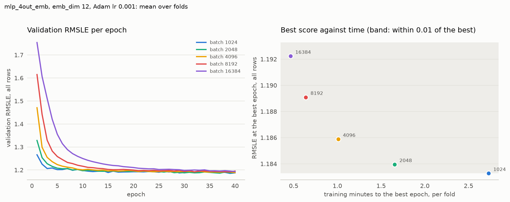

# Experiment 04: Batch size

## Request

create experiment 04 for choosing batch size

## Question

Which batch size, out of 1024, 2048, 4096, 8192 and 16384, gives the lowest fold-average validation RMSLE at its best epoch, and which of the sizes within 0.01 of that best reaches its best epoch in the least training time?

## Plan

Train mlp_4out_emb with each batch size for 40 epochs on the 4 seasonal folds and score each run at its best epoch, averaged over folds. Plot validation RMSLE per epoch, mean over folds, one colour per size, and report time to the best epoch. Among the sizes within 0.01 of the best, pick the fastest.

## Setup

- **Notebook:** [exp04_batch_size.ipynb](../notebooks/experiments/exp04_batch_size.ipynb)
- **Tracking:** MLflow `ashrae-mlp-batch-size`, session `2026-10-12 15:01:13`, 20 runs named `mlp_4out_emb | batch <size> | <fold>`, tag `notebook = exp04_batch_size`
- **What changes:** batch size: 1024, 2048, 4096, 8192, 16384
- **What stays fixed:** mlp_4out_emb, emb_dim 12, 2 hidden layers of 64, ReLU, one output per meter type, Adam (lr 1e-3), 40 epochs, features from [ashrae/features.py](../../ashrae/features.py), 2M training / 500K validation rows per fold, anomalies dropped from training only, seed 0
- **Metric:** validation RMSLE at the best epoch, per fold and averaged, all rows and clean rows; the best epoch; training RMSLE at the same epoch; validation RMSLE per epoch, mean over folds; seconds per epoch and training time to the best epoch

## Results

| batch size | Jan–Mar | Apr–Jun | Jul–Sep | Oct–Dec | average | average, clean rows | best epoch | training | seconds per epoch | minutes to best epoch |
| --- | --- | --- | --- | --- | --- | --- | --- | --- | --- | --- |
| 1024 | 1.405 | 1.210 | 1.019 | 1.099 | 1.183 | 0.922 | 29.00 | 0.791 | 5.606 | 2.729 |
| 2048 | 1.402 | 1.212 | 1.019 | 1.103 | 1.184 | 0.921 | 32.25 | 0.794 | 3.080 | 1.655 |
| 4096 | 1.408 | 1.210 | 1.025 | 1.100 | 1.186 | 0.923 | 35.25 | 0.797 | 1.717 | 1.009 |
| 8192 | 1.409 | 1.216 | 1.028 | 1.103 | 1.189 | 0.926 | 35.75 | 0.803 | 1.072 | 0.639 |
| 16384 | 1.410 | 1.218 | 1.039 | 1.103 | 1.192 | 0.931 | 38.25 | 0.814 | 0.729 | 0.465 |

Validation RMSLE at each run's best epoch, all rows (500K per fold) unless noted, per fold and mean over the 4 folds; best epoch, training RMSLE at it, seconds per epoch and training minutes to the best epoch are means over folds.

## AI Summary

Batch 1024 gives the lowest RMSLE, 1.183, but all five sizes are within 0.01 of it, and 16384 is the fastest of them, reaching its best epoch in about 0.5 minutes per fold against 2.7 for 1024. Its 1.192 is only just inside the threshold, and on 2 of 4 folds its best epoch is the last one, so it is still improving at epoch 40.

## Conclusion

The compression is biased toward smaller batch sizes, because as learning rate experiment on 4096 showed, even after lr=1e-2 it can be improved. For bigger batch sizes it can be even bigger.

Despite bias, smaller batch sizes showed improvement below 0.003, which is below threshold, so they are excluded.

Bigger batch sizes should be reanalyzed with bigger learning rates.
