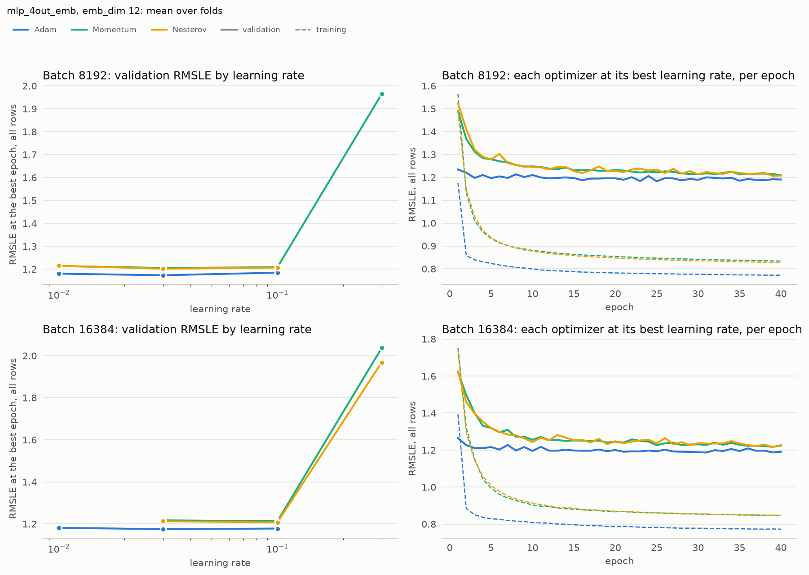

# Experiment 06: Optimizers at large batch

## Request

increment 06,07,08, create experiment 06 which tests Adam, Nesterov, Momentum for 8192 and 16384 by the same approach as in 05, but using higher learning rates

## Question

At batch 8192 and at batch 16384, which of Adam, Momentum and Nesterov, each at its best learning rate, gives the lowest fold-average validation RMSLE at the best epoch?

## Plan

Repeat [exp05](exp05_optimizers.md) at batch 8192 and 16384: train mlp_4out_emb with emb_dim 12 using each optimizer at 3 learning rates for 40 epochs on the 4 seasonal folds. Score each run at its best epoch, read from the validation curve after training, and average over folds. The grids start at exp05's best rate at batch 4096 and go up, since larger batches take fewer steps per epoch and usually need higher rates. Compare the optimizers at each batch size, each at its best learning rate. If that rate is at the edge of its grid, add one more rate in that direction. A run that diverges counts as a failed rate.

## Setup

- **Notebook:** [exp06_optimizers_large_batch.ipynb](../notebooks/experiments/exp06_optimizers_large_batch.ipynb)
- **Tracking:** MLflow `ashrae-mlp-optimizers-large-batch`, session `2026-10-12 19:15:33`, 80 finished runs named `mlp_4out_emb | batch <size> | <optimizer> lr <lr> | <fold>`, tag `notebook = exp06_optimizers_large_batch`
- **What changes:** batch 8192 and 16384; Adam lr 1e-2, 3e-2, 1e-1; Momentum 0.9 lr 3e-2, 1e-1, 3e-1; Nesterov 0.9 lr 3e-2, 1e-1, 3e-1; same grids for both batch sizes; added at the edge: Momentum lr 1e-2 and Nesterov lr 1e-2 at batch 8192
- **What stays fixed:** mlp_4out_emb, emb_dim 12, 2 hidden layers of 64, ReLU, no BatchNorm, no weight decay, one output per meter type, 40 epochs, no learning-rate schedule or warmup, features from [ashrae/features.py](../../ashrae/features.py), 2M training / 500K validation rows per fold, anomalies dropped from training only, seed 0
- **Metric:** validation RMSLE at the best epoch, per fold and averaged, all rows and clean rows; the best epoch; training RMSLE at the same epoch; mean change between consecutive epochs over the 5 epochs before the best one

## Results

Validation RMSLE at each run's best epoch, all rows (500K per fold), mean over the 4 folds; on the right, per-epoch validation (solid) and training (dashed) RMSLE. Nesterov at lr 3e-1 and batch 8192 diverged in 2 folds and has no point.

## AI Summary

Adam is best at both batch sizes and in every fold: at lr 3e-2 it scores 1.173 at batch 8192 and 1.175 at batch 16384, against 1.202 and 1.207 for the better SGD variant, Nesterov. Every best rate lies inside its grid, and SGD fails at lr 3e-1 at both batch sizes.

## Conclusion

Keep Adam as optimizer for all batch sizes. It achieved best performance for lr = 3 * 1e-2. Graphs for this lr are fluctuating and model stops training early. Next step is direct comparison of 4096, 8192 16384
