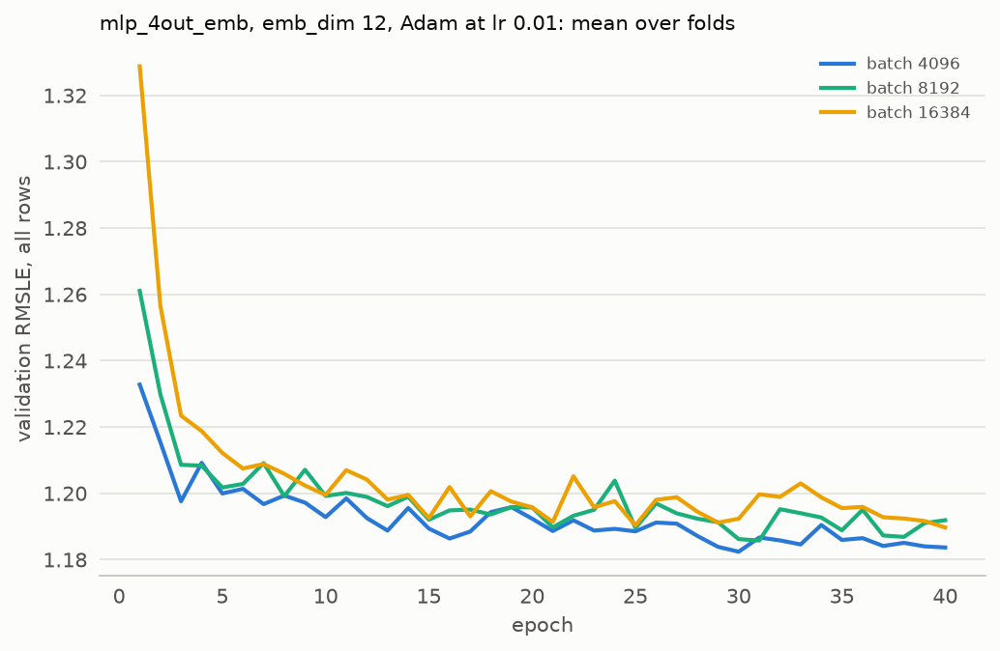
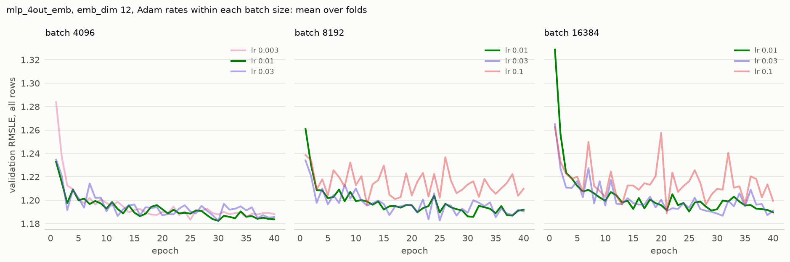

# Experiment 07: Batch size at best learning rate

## Request

Increment 07,08,09, creae 07 experiment where compare 4092, 8192, 16384 at their best learning rate

## Question

With Adam at each size's best learning rate, which of batch 4096, 8192 and 16384 gives the lowest fold-average validation RMSLE at its best epoch, and which of the sizes within 0.01 of that best reaches its best epoch in the least training time?

## Plan

Compare mlp_4out_emb with Adam at batch 4096 (lr 1e-2 and 3e-2, keeping the lower score), 8192 (lr 3e-2) and 16384 (lr 3e-2), 40 epochs on the 4 seasonal folds with no early stopping. Only batch 4096 at lr 3e-2 is trained; the other runs are read from MLflow. Training time to the best epoch is the best epoch times the mean seconds per epoch of that batch size from exp04. Score each run at its best epoch and average over folds. Plot validation RMSLE per epoch, mean over folds, one colour per size at lr 1e-2, and in a second figure one panel per size comparing its Adam rates from 3e-3 to 0.1 tried in exp05, exp06 and here, on the first figure's y range. In the panels, lr 1e-2 is opaque and the other rates are at half opacity. Among the sizes within 0.01 of the best, pick the fastest. Show clean-row RMSLE per fold for each size at lr 1e-2 and at its best rate, to check whether the order of sizes holds in every fold.

## Setup

- **Notebook:** [exp07_batch_size_best_lr.ipynb](../notebooks/experiments/exp07_batch_size_best_lr.ipynb)
- **Tracking:** MLflow `ashrae-mlp-batch-size-best-lr`, runs named `mlp_4out_emb | batch <size> | lr <lr> | <fold>`, tag `notebook = exp07_batch_size_best_lr` (batch 4096, lr 3e-2); reused: batch 4096 lr 1e-2 from `ashrae-mlp-optimizers`, session `2026-10-12 13:42:10` ([exp05](exp05_optimizers.md)); batch 8192 and 16384 lr 3e-2 from `ashrae-mlp-optimizers-large-batch`, session `2026-10-12 19:15:33` ([exp06](exp06_optimizers_large_batch.md)); seconds per epoch from `ashrae-mlp-batch-size`, session `2026-10-12 15:01:13` ([exp04](exp04_batch_size.md))
- **What changes:** batch size and its learning rate: 4096 at lr 1e-2 and 3e-2, 8192 at lr 3e-2, 16384 at lr 3e-2
- **What stays fixed:** mlp_4out_emb, emb_dim 12, 2 hidden layers of 64, ReLU, no BatchNorm, no weight decay, one output per meter type, Adam, 40 epochs, no learning-rate schedule, warmup or early stopping, features from [ashrae/features.py](../../ashrae/features.py), 2M training / 500K validation rows per fold, anomalies dropped from training only, seed 0
- **Metric:** validation RMSLE at the best epoch, per fold and averaged, all rows and clean rows; the best epoch; training RMSLE at the same epoch; mean change between consecutive epochs over the 5 epochs before the best one; seconds per epoch (from exp04) and training time to the best epoch

## Results

| batch at lr 1e-2 | RMSLE, all rows | RMSLE, clean rows | best epoch | minutes to best epoch |
| --- | --- | --- | --- | --- |
| 4096 | 1.176 | 0.913 | 29.0 | 0.83 |
| 8192 | 1.180 | 0.920 | 30.0 | 0.54 |
| 16384 | 1.182 | 0.927 | 26.5 | 0.32 |

| batch at its best lr | best lr | RMSLE, all rows | RMSLE, clean rows | best epoch | minutes to best epoch |
| --- | --- | --- | --- | --- | --- |
| 4096 | 3e-2 | 1.175 | 0.919 | 27.8 | 0.79 |
| 8192 | 3e-2 | 1.173 | 0.923 | 22.5 | 0.40 |
| 16384 | 3e-2 | 1.175 | 0.930 | 24.5 | 0.30 |

| batch at lr 1e-2, clean rows | Jan–Mar | Apr–Jun | Jul–Sep | Oct–Dec |
| --- | --- | --- | --- | --- |
| 4096 | 0.908 | 0.875 | 0.869 | 1.001 |
| 8192 | 0.916 | 0.886 | 0.874 | 1.004 |
| 16384 | 0.930 | 0.886 | 0.878 | 1.013 |

| batch at its best lr, clean rows | Jan–Mar | Apr–Jun | Jul–Sep | Oct–Dec |
| --- | --- | --- | --- | --- |
| 4096 | 0.929 | 0.875 | 0.869 | 1.003 |
| 8192 | 0.930 | 0.894 | 0.869 | 0.998 |
| 16384 | 0.945 | 0.895 | 0.879 | 1.002 |

Validation RMSLE at each run's best epoch, mean over the 4 folds unless split by fold, on all rows (500K per fold) and on clean rows; the figures show the per-epoch curves averaged over folds.

## AI Summary

The best rate by score alone matters less than stability: lr 3e-2 scores lowest, but its curves are less stable than those of lr 1e-2, so lr 1e-2 is chosen for every batch size. At lr 1e-2, batch 16384 reaches its best epoch about 2.6 times faster than batch 4096 (0.32 against 0.83 minutes per fold), and its RMSLE is only 0.006 worse (1.182 against 1.176), inside the 0.01 threshold. Batch 16384 is worth keeping, and the next step is to try it at lr 2e-2 to improve its score.

## Conclusion

By the rule: "take the fastest within 0.01 threshhold", 16384 wins, but it degradates at clean rows (0.014 worse than 4096), so I prefer 8192 at 1e-2, which gives 50% training speed boost.
