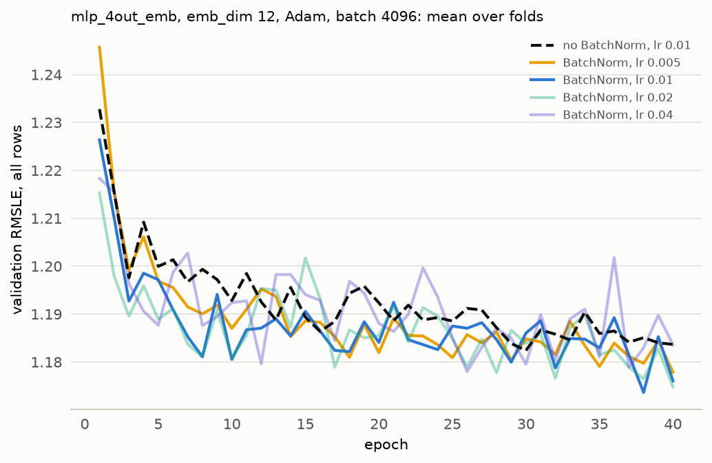

# Experiment 09: BatchNorm

## Request

add exp09 to turn on/off batchnorm on current model

## Question

Does BatchNorm in the hidden layers, at its best Adam learning rate, lower the fold-average validation RMSLE at the best epoch of mlp_4out_emb (emb_dim 12, batch 4096) below the 1.176 it reaches without BatchNorm at lr 1e-2?

## Plan

Train with BatchNorm at lr 5e-3, 1e-2 and 2e-2 for 40 epochs on the 4 folds; the run without BatchNorm is read from MLflow. Score each run at its best epoch, averaged over folds, and extend the grid if the best rate is at its edge. Plot validation curves per rate against the run without BatchNorm.

## Setup

- **Notebook:** [exp09_batch_norm.ipynb](../notebooks/experiments/exp09_batch_norm.ipynb)
- **Tracking:** MLflow `ashrae-mlp-batch-norm`, session `2026-10-12 21:52:51`, 16 runs named `mlp_4out_emb_bn | lr <lr> | <fold>`, tag `notebook = exp09_batch_norm`; reused: without BatchNorm at batch 4096, lr 1e-2 from `ashrae-mlp-optimizers`, session `2026-10-12 13:42:10` ([exp05](exp05_optimizers.md))
- **What changes:** BatchNorm off (lr 1e-2) or on (lr 5e-3, 1e-2, 2e-2, and 4e-2 after 2e-2 tied for best at the grid's edge)
- **What stays fixed:** mlp_4out_emb, emb_dim 12, 2 hidden layers of 64, ReLU, one output per meter type, Adam, batch 4096, no weight decay, 40 epochs, no learning-rate schedule, warmup or early stopping, features from [ashrae/features.py](../../ashrae/features.py), 2M training / 500K validation rows per fold, anomalies dropped from training only, seed 0
- **Metric:** validation RMSLE at the best epoch, per fold and averaged, all rows and clean rows; the best epoch; training RMSLE at the same epoch; mean change between consecutive epochs over the 5 epochs before the best one; seconds per epoch and training time to the best epoch

## Results

Validation RMSLE per epoch on all rows (500K per fold), mean over the 4 folds.

## AI Summary

Yes, but not significantly: with BatchNorm at lr 1e-2 the fold-average RMSLE drops from 1.176 to 1.168 (delta = 0.008) and is lower in every fold, though on clean rows only from 0.913 to 0.912 (delta = 0.001).

| BatchNorm, lr | Jan–Mar | Apr–Jun | Jul–Sep | Oct–Dec | average | average, clean rows |
| --- | --- | --- | --- | --- | --- | --- |
| off, 1e-2 | 1.399 | 1.204 | 1.011 | 1.090 | 1.176 | 0.913 |
| on, 5e-3 | 1.394 | 1.201 | 1.010 | 1.091 | 1.174 | 0.915 |
| on, 1e-2 | 1.386 | 1.195 | 1.008 | 1.085 | 1.168 | 0.912 |
| on, 2e-2 | 1.390 | 1.192 | 1.004 | 1.086 | 1.168 | 0.908 |
| on, 4e-2 | 1.381 | 1.198 | 1.011 | 1.087 | 1.169 | 0.914 |

Validation RMSLE at the best epoch per fold (500K rows each), all rows unless noted.

BatchNorm scores lower than the run without it in 18 of 20 rate–fold pairs (the exceptions are lr 5e-3 in Oct–Dec, +0.001, and lr 4e-2 in Jul–Sep, a tie). The gain is largest in Jan–Mar (0.005 to 0.018) and smallest in Jul–Sep (0 to 0.007).

Against BatchNorm at lr 5e-3 (1.174, clean rows 0.915), lr 1e-2 scores 0.006 lower, but its curve changes about twice as much between epochs before the best one (0.013 against 0.007) and it reaches its best epoch later (35 against 27, 1.23 against 0.93 minutes per fold).

## Conclusion

BN with lr 0.01 improves score not significantly (0.008 on val, below 0.01) but consistently across different folds, so I would keep it.

