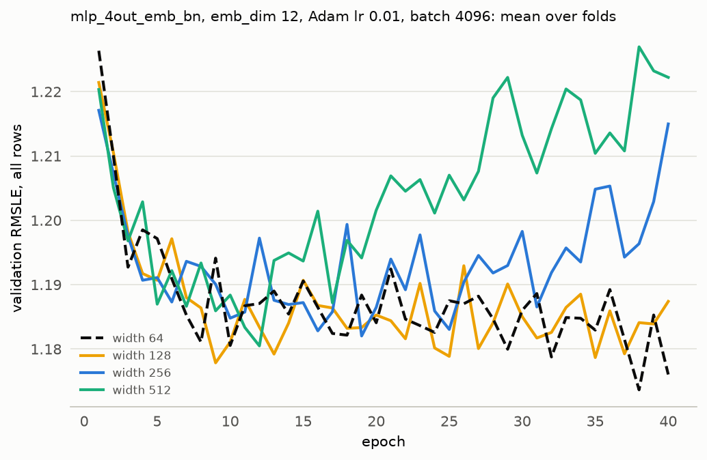

# Experiment 10: Hidden layer width

## Request

change MeterMLP and build_blocks to be able to change width. add width change experiment (consider only bigger width)

## Question

Does widening the 2 hidden layers of mlp_4out_emb with BatchNorm (emb_dim 12, Adam lr 1e-2, batch 4096) from 64 to 128, 256 or 512 units lower the fold-average validation RMSLE at the best epoch by more than 0.01 below 1.168?

## Plan

Train widths 128, 256 and 512 for 40 epochs on the 4 folds; width 64 is read from MLflow. Score each run at its best epoch, per fold and averaged over folds. Plot validation curves per width.

## Setup

- **Notebook:** [exp10_width.ipynb](../notebooks/experiments/exp10_width.ipynb)
- **Tracking:** MLflow `ashrae-mlp-width`, runs named `mlp_4out_emb_bn | width <width> | <fold>`, tag `notebook = exp10_width`; reused: width 64 from `ashrae-mlp-batch-norm`, session `2026-10-12 21:52:51`, BatchNorm at lr 1e-2 ([exp09](exp09_batch_norm.md))
- **What changes:** hidden layer width 64 (reused), 128, 256 or 512
- **What stays fixed:** mlp_4out_emb, emb_dim 12, 2 hidden layers, BatchNorm, ReLU, one output per meter type, Adam lr 1e-2, batch 4096, no weight decay, 40 epochs, no learning-rate schedule, warmup or early stopping, features from [ashrae/features.py](../../ashrae/features.py), 2M training / 500K validation rows per fold, anomalies dropped from training only, seed 0
- **Metric:** validation RMSLE at the best epoch, per fold and averaged, all rows and clean rows; the best epoch; training RMSLE at the same epoch; number of parameters outside the embedding; seconds per epoch and training time to the best epoch

## Results

Validation RMSLE per epoch on all rows (500K per fold), mean over the 4 folds.

## AI Summary

No: no wider layer beats width 64 (1.168); 128 scores 1.170, and 256 and 512 both 1.174, though 128 is slightly lower on clean rows (0.908 against 0.912). Wider networks reach their best epoch sooner (35 for 64, 12 for 512) and then get worse: from about epoch 15, the validation curves of 256 and 512 rise steadily.

## Conclusion

Either LR is too high or wider layer overfits, try 3 1e-2.
