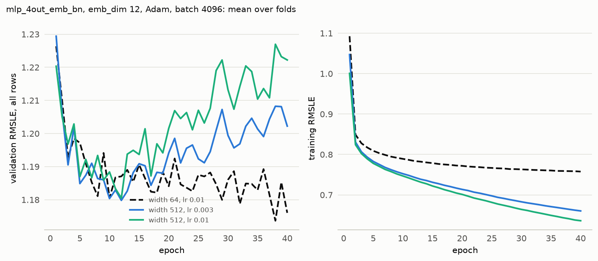

# Experiment 11: Width 512 at a lower learning rate

## Request

create experiment 11; compare lr=3*1e-3 for 512 to 512 with lr=1e-2 and current model (64, lr=1e-2)

## Question

Does width 512 at Adam lr 3e-3 lower the fold-average validation RMSLE at the best epoch below the 1.174 of width 512 at lr 1e-2, and does it come within 0.01 of the 1.168 of width 64 at lr 1e-2?

## Plan

Train width 512 at lr 3e-3 for 40 epochs on the 4 folds; width 512 and width 64 at lr 1e-2 are read from MLflow. Score each run at its best epoch, per fold and averaged over folds. Plot mean validation and training curves per run setup.

## Setup

- **Notebook:** [exp11_width_lr.ipynb](../notebooks/experiments/exp11_width_lr.ipynb)
- **Tracking:** MLflow `ashrae-mlp-width-lr`, runs named `mlp_4out_emb_bn | width 512 | lr 3e-3 | <fold>`, tag `notebook = exp11_width_lr`; reused: width 512 at lr 1e-2 from `ashrae-mlp-width`, session `2026-10-12 22:43:11` ([exp10](exp10_width.md)), and width 64 at lr 1e-2 from `ashrae-mlp-batch-norm`, session `2026-10-12 21:52:51` ([exp09](exp09_batch_norm.md))
- **What changes:** width 512 at lr 3e-3 (trained) or 1e-2 (reused); width 64 at lr 1e-2 (reused)
- **What stays fixed:** mlp_4out_emb, emb_dim 12, 2 hidden layers, BatchNorm, ReLU, one output per meter type, Adam, batch 4096, no weight decay, 40 epochs, no learning-rate schedule, warmup or early stopping, features from [ashrae/features.py](../../ashrae/features.py), 2M training / 500K validation rows per fold, anomalies dropped from training only, seed 0
- **Metric:** validation RMSLE at the best epoch, per fold and averaged, all rows and clean rows; the best epoch; training RMSLE at the best epoch and at epoch 40; seconds per epoch and training time to the best epoch

## Results

Validation RMSLE on all rows (500K per fold) and training RMSLE per epoch, mean over the 4 folds.

## AI Summary

No: width 512 at lr 3e-3 scores 1.175, no better than 1.174 at lr 1e-2, and it does come within 0.01 of width 64 (1.168), as 512 at lr 1e-2 already did. Its training RMSLE still falls smoothly to 0.660 at epoch 40 while validation rises after about epoch 12, so the lower rate only slows the overfitting slightly.

## Conclusion

Wider models tend to overfitting.
