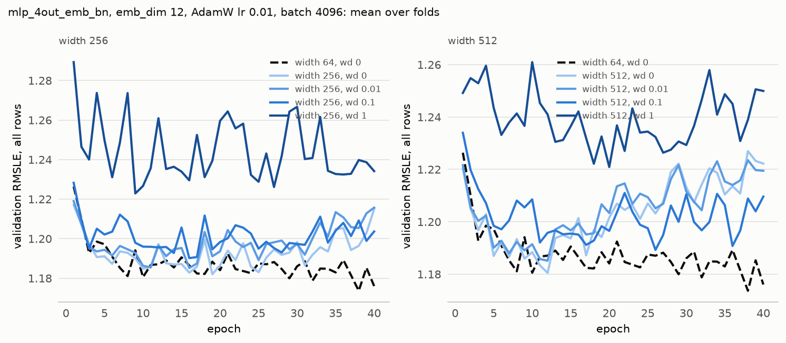

# Experiment 12: Weight decay for widths 256 and 512

## Request

create exp12 weight decay for 512 and 256

## Question

Does AdamW weight decay lower the fold-average validation RMSLE at the best epoch of width 256 or 512 below their 1.174 without it, and does either come more than 0.01 below the 1.168 of width 64?

## Plan

Train widths 256 and 512 at AdamW weight decay 0.01, 0.1 and 1 for 40 epochs on the 4 folds; both widths without weight decay and width 64 are read from MLflow. Score each run at its best epoch, per fold and averaged over folds, and extend the grid if the best decay is at its edge. Plot mean validation curves per width and decay.

## Setup

- **Notebook:** [exp12_width_weight_decay.ipynb](../notebooks/experiments/exp12_width_weight_decay.ipynb)
- **Tracking:** MLflow `ashrae-mlp-width-weight-decay`, runs named `mlp_4out_emb_bn | width <width> | wd <wd> | <fold>`, tag `notebook = exp12_width_weight_decay`; reused: widths 256 and 512 without weight decay from `ashrae-mlp-width`, session `2026-10-12 22:43:11` ([exp10](exp10_width.md)), and width 64 from `ashrae-mlp-batch-norm`, session `2026-10-12 21:52:51` ([exp09](exp09_batch_norm.md))
- **What changes:** width 256 or 512; weight decay 0 (reused), 0.01, 0.1 or 1, applied to weight matrices and embeddings only
- **What stays fixed:** mlp_4out_emb, emb_dim 12, 2 hidden layers, BatchNorm, ReLU, one output per meter type, AdamW lr 1e-2, batch 4096, 40 epochs, no learning-rate schedule, warmup or early stopping, features from [ashrae/features.py](../../ashrae/features.py), 2M training / 500K validation rows per fold, anomalies dropped from training only, seed 0
- **Metric:** validation RMSLE at the best epoch, per fold and averaged, all rows and clean rows; the best epoch; training RMSLE at the best epoch and at epoch 40; seconds per epoch and training time to the best epoch

## Results

Validation RMSLE per epoch on all rows (500K per fold), mean over the 4 folds.

## AI Summary

No: every decay scores at or above the 1.174 without it (width 256: 1.176, 1.180 and 1.210 at 0.01, 0.1 and 1; width 512: 1.175, 1.179 and 1.208), so neither width comes near width 64 (1.168), let alone 0.01 below it. RMSLE rises steadily with decay, and from about epoch 15 the validation curves still climb at 0.01 and 0.1, so weight decay doesn't stop the wider networks from overfitting.

## Conclusion

In current configuration Decay did not help.

Note that actually renormalizing in batch norm makes inner hidden layers immutable to Weight Decay, so the only thing that it decaded is output channels and inputs, which do not make because it was very clear that model width is actually the thing that makes the model perform worse.
