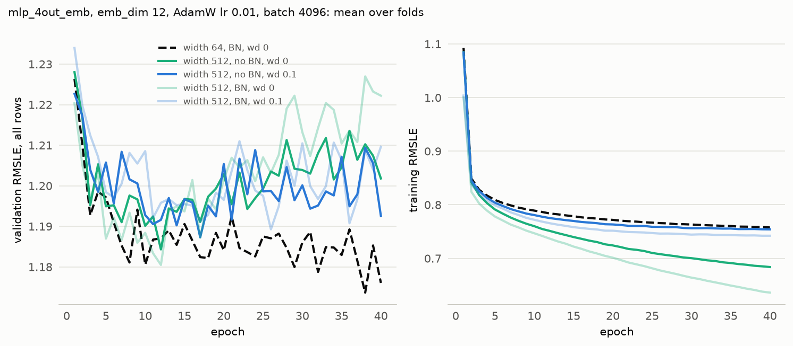

# Experiment 13: Weight decay for width 512 without BatchNorm

## Request

create experiment 13: compare 512 without BN and WD=0.1 with 512 without BN and widthout WD and 64 wd 0

## Question

Does AdamW weight decay 0.1 lower the fold-average validation RMSLE at the best epoch of width 512 without BatchNorm below its score without decay, and does it come more than 0.01 below the 1.168 of width 64?

## Plan

Train width 512 without BatchNorm at weight decay 0 and 0.1 for 40 epochs on the 4 folds; width 64 and width 512 with BatchNorm at weight decay 0 and 0.1 are read from MLflow. Score each run at its best epoch, per fold and averaged over folds. Plot mean validation and training curves per run setup, with the width 512 BatchNorm runs as faint lines.

## Setup

- **Notebook:** [exp13_width_no_bn_weight_decay.ipynb](../notebooks/experiments/exp13_width_no_bn_weight_decay.ipynb)
- **Tracking:** MLflow `ashrae-mlp-width-no-bn-weight-decay`, runs named `mlp_4out_emb | width 512 | wd <wd> | <fold>`, tag `notebook = exp13_width_no_bn_weight_decay`; reused: width 64 with BatchNorm, no weight decay, lr 1e-2 from `ashrae-mlp-batch-norm`, session `2026-10-12 21:52:51` ([exp09](exp09_batch_norm.md)); width 512 with BatchNorm at weight decay 0 from `ashrae-mlp-width`, session `2026-10-12 22:43:11` ([exp10](exp10_width.md)), and at weight decay 0.1 from `ashrae-mlp-width-weight-decay`, session `2026-10-12 23:52:14` ([exp12](exp12_width_weight_decay.md))
- **What changes:** width 512 without BatchNorm at weight decay 0 or 0.1 (trained); width 512 with BatchNorm at weight decay 0 or 0.1 and width 64 with BatchNorm at weight decay 0 (reused)
- **What stays fixed:** mlp_4out_emb, emb_dim 12, 2 hidden layers, ReLU, one output per meter type, AdamW lr 1e-2 (plain Adam at decay 0), decay on weight matrices and embeddings only, batch 4096, 40 epochs, no learning-rate schedule, warmup or early stopping, features from [ashrae/features.py](../../ashrae/features.py), 2M training / 500K validation rows per fold, anomalies dropped from training only, seed 0
- **Metric:** validation RMSLE at the best epoch, per fold and averaged, all rows and clean rows; the best epoch; training RMSLE at the best epoch and at epoch 40; seconds per epoch and training time to the best epoch

## Results

Validation RMSLE on all rows (500K per fold) and training RMSLE, per epoch, mean over the 4 folds.

## AI Summary

No: without BatchNorm, weight decay 0.1 scores 1.181 against 1.179 without it, both above width 64's 1.168, so neither comes 0.01 below it. Decay holds training RMSLE at 0.754 by epoch 40 (0.684 without), the level of width 64, yet validation does not improve.

## Conclusion

BatchNorm was not the problem. Weight decay does not work here. Keep BatchNorm and try dropout.
