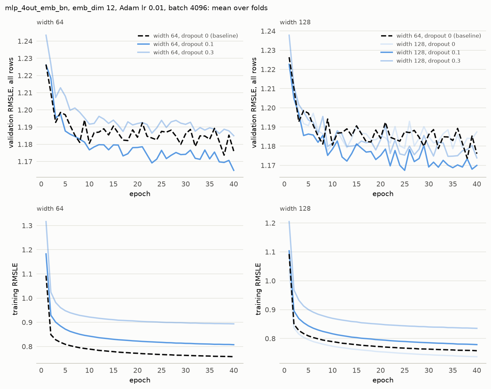

# Experiment 15: Dropout for widths 64 and 128

## Request

create experiment: dropouts on small width sizes, compare 64 and 128 for dropouts 0.1 and 0.3

baseline is still 64 with no dropout. output is 2 plots: first is the same ax for exp14 but for 64 and 128, 2nd is final comparison of best dropout rates for all width sizes

## Question

Does dropout 0.1 or 0.3 on width 64 or 128 lower the fold-average validation RMSLE at the best epoch more than 0.01 below the 1.168 of width 64 without dropout, and which of widths 64, 128, 256 and 512 at its best dropout scores lowest?

## Plan

Train widths 64 and 128 at dropout 0.1 and 0.3. Width 64 without dropout is the baseline. Pick each width's best dropout by fold-average validation RMSLE at the best epoch. Figure 1 has the exp14 layout for widths 64 and 128: mean validation and training curves per dropout, one column per width. Figure 2 compares widths 64, 128, 256 and 512 at their best dropout by mean validation and training curves. Both figures show the baseline dashed.

## Setup

- **Notebook:** [exp15_small_width_dropout.ipynb](../notebooks/experiments/exp15_small_width_dropout.ipynb)
- **Tracking:** MLflow `ashrae-mlp-small-width-dropout`, session `2026-10-13 09:06:41`, 16 runs named `mlp_4out_emb_bn | width <width> | dropout 
 | <fold>`, tag `notebook = exp15_small_width_dropout`; reused: width 64 without dropout from `ashrae-mlp-batch-norm`, session `2026-10-12 21:52:51` ([exp09](exp09_batch_norm.md)), width 128 without dropout from `ashrae-mlp-width`, session `2026-10-12 22:43:11` ([exp10](exp10_width.md)), widths 256 and 512 at dropout 0.3 from `ashrae-mlp-width-dropout`, session `2026-10-13 08:00:20` ([exp14](exp14_width_dropout.md))
- **What changes:** width 64 or 128 at dropout 0 (reused), 0.1 or 0.3 after each hidden layer; widths 256 and 512 at dropout 0.3 (reused)
- **What stays fixed:** mlp_4out_emb, emb_dim 12, 2 hidden layers, BatchNorm, ReLU, one output per meter type, Adam lr 1e-2, no weight decay, batch 4096, 40 epochs, no learning-rate schedule, warmup or early stopping, features from [ashrae/features.py](../../ashrae/features.py), 2M training / 500K validation rows per fold, anomalies dropped from training only, seed 0
- **Metric:** validation RMSLE at the best epoch and at epoch 40, per fold and averaged, all rows and clean rows; the best epoch; training RMSLE at the best epoch and at epoch 40; seconds per epoch and training time to the best epoch

## Results

Validation RMSLE on all rows (500K per fold) and training RMSLE, per epoch, mean over the 4 folds.

## AI Summary

No: the best small width is 64 at dropout 0.1 with 1.162 (128 at 0.1 scores 1.163), only 0.006 below the baseline's 1.168, while dropout 0.3 hurts width 64 (1.182) and leaves 128 unchanged (1.170). Width 512 at dropout 0.3 scores lowest at 1.159, but all four widths at their best dropout lie within 0.004 of each other (1.159 to 1.163). Width 512 at 0.3 beats 64 at 0.1 by 0.003 on average, but 0.009 of that comes from Oct–Dec and the other folds differ by 0.003 at most; at epoch 40 the order flips (1.165 for 64 against 1.170 for 512), and both take about 2 seconds per epoch.

## Conclusion

Keep width 64 with dropout = 0.1
