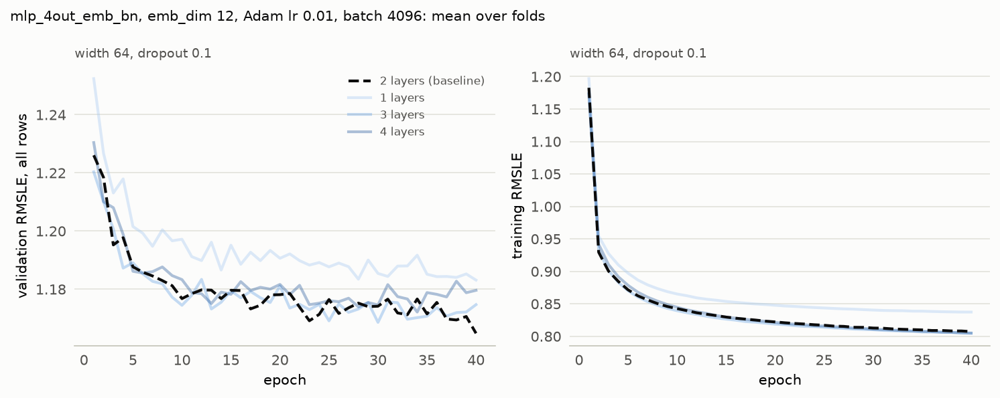

# Experiment 16: Number of hidden layers

## Request

create experiment 16 for choose layer depth

## Question

Does 1, 3 or 4 hidden layers of width 64 at dropout 0.1 lower the fold-average validation RMSLE at the best epoch more than 0.01 below the 1.162 of 2 layers?

## Plan

Train 1, 3 and 4 hidden layers. The baseline is 2 layers, reused from exp15. Pick the depth with the lowest fold-average validation RMSLE at the best epoch. The figure shows mean validation and training curves per depth, with the baseline dashed and depths other than the winner drawn at lower opacity.

## Setup

- **Notebook:** [exp16_depth.ipynb](../notebooks/experiments/exp16_depth.ipynb)
- **Tracking:** MLflow `ashrae-mlp-depth`, session `2026-10-13 10:01:49`, 12 runs named `mlp_4out_emb_bn | layers <n> | <fold>`, tag `notebook = exp16_depth`; reused: 2 layers at width 64 and dropout 0.1 from `ashrae-mlp-small-width-dropout`, session `2026-10-13 09:06:41` ([exp15](exp15_small_width_dropout.md))
- **What changes:** 1, 2 (reused), 3 or 4 hidden layers
- **What stays fixed:** mlp_4out_emb, emb_dim 12, width 64, dropout 0.1 after each hidden layer, BatchNorm, ReLU, one output per meter type, Adam lr 1e-2, no weight decay, batch 4096, 40 epochs, no learning-rate schedule, warmup or early stopping, features from [ashrae/features.py](../../ashrae/features.py), 2M training / 500K validation rows per fold, anomalies dropped from training only, seed 0
- **Metric:** validation RMSLE at the best epoch and at epoch 40, per fold and averaged, all rows and clean rows; the best epoch; training RMSLE at the best epoch and at epoch 40; seconds per epoch and training time to the best epoch

## Results

Validation RMSLE on all rows (500K per fold) and training RMSLE, per epoch, mean over the 4 folds.

## AI Summary

No: 2 layers stay best at 1.162; 3 layers score 1.164, 4 layers 1.169 and 1 layer 1.179, and no depth beats 2 layers on more than one fold. Extra layers lower training RMSLE by only 0.001 to 0.004, so the added depth doesn't reach validation.

## Conclusion

Keep 2 layers. There is also potential to try dfferent dropout rates for layer sizes 3 & 4, but I do not expect difference that is higher then 0.01 threshold.
