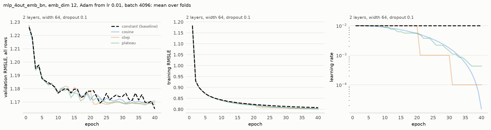

# Experiment 17: Learning-rate schedule

## Request

Create experiment 17 for LR scheduling

## Question

Does cosine annealing, step decay or reduce-on-plateau lower the fold-average validation RMSLE at the best epoch more than 0.01 below the 1.162 of a constant learning rate?

## Plan

Train 2 hidden layers with three schedules, all starting at lr 1e-2: cosine annealing to 0 over 40 epochs, step decay by 10 at epochs 20 and 30, and reduce-on-plateau halving the rate after 3 epochs without a lower validation RMSLE. The constant learning rate is the baseline, reused from exp15. Pick the schedule with the lowest fold-average validation RMSLE at the best epoch. The figure shows mean validation and training curves and the learning rate per epoch for each schedule, with the baseline dashed and schedules other than the winner drawn at lower opacity.

## Setup

- **Notebook:** [exp17_lr_schedule.ipynb](../notebooks/experiments/exp17_lr_schedule.ipynb)
- **Tracking:** MLflow `ashrae-mlp-lr-schedule`, session `2026-10-13 10:29:04`, 12 runs named `mlp_4out_emb_bn | <schedule> | <fold>`, tag `notebook = exp17_lr_schedule`; reused: constant lr at 2 layers, width 64 and dropout 0.1 from `ashrae-mlp-small-width-dropout`, session `2026-10-13 09:06:41` ([exp15](exp15_small_width_dropout.md))
- **What changes:** learning-rate schedule: constant (reused), cosine, step or plateau
- **What stays fixed:** mlp_4out_emb, emb_dim 12, 2 hidden layers of width 64 ([exp16](exp16_depth.md)), dropout 0.1 after each hidden layer, BatchNorm, ReLU, one output per meter type, Adam with starting lr 1e-2, no weight decay, batch 4096, 40 epochs, no warmup or early stopping, features from [ashrae/features.py](../../ashrae/features.py), 2M training / 500K validation rows per fold, anomalies dropped from training only, seed 0
- **Metric:** validation RMSLE at the best epoch and at epoch 40, per fold and averaged, all rows and clean rows; the best epoch; training RMSLE at the best epoch and at epoch 40; learning rate per epoch; seconds per epoch and training time to the best epoch

## Results

Validation RMSLE on all rows (500K per fold) and training RMSLE, per epoch, mean over the 4 folds.

## AI Summary

No: the constant rate stays best at 1.162 against 1.166 for plateau and 1.167 for cosine and step, and no schedule beats it on any fold (at best they tie, on Apr–Jun and Oct–Dec). The schedules do steady the validation curve after epoch 20 (around 1.169 against the constant rate's swings between 1.165 and 1.177), so the constant rate's lead comes partly from picking its luckiest epoch per fold.

## Conclusion

No schedle imporves the score, but decaying learning rate is useful to reduce noice. pick step.
