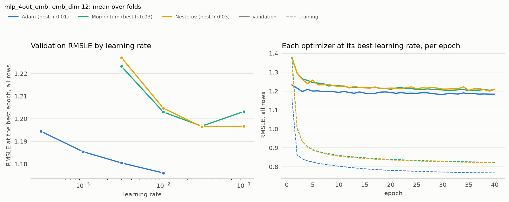
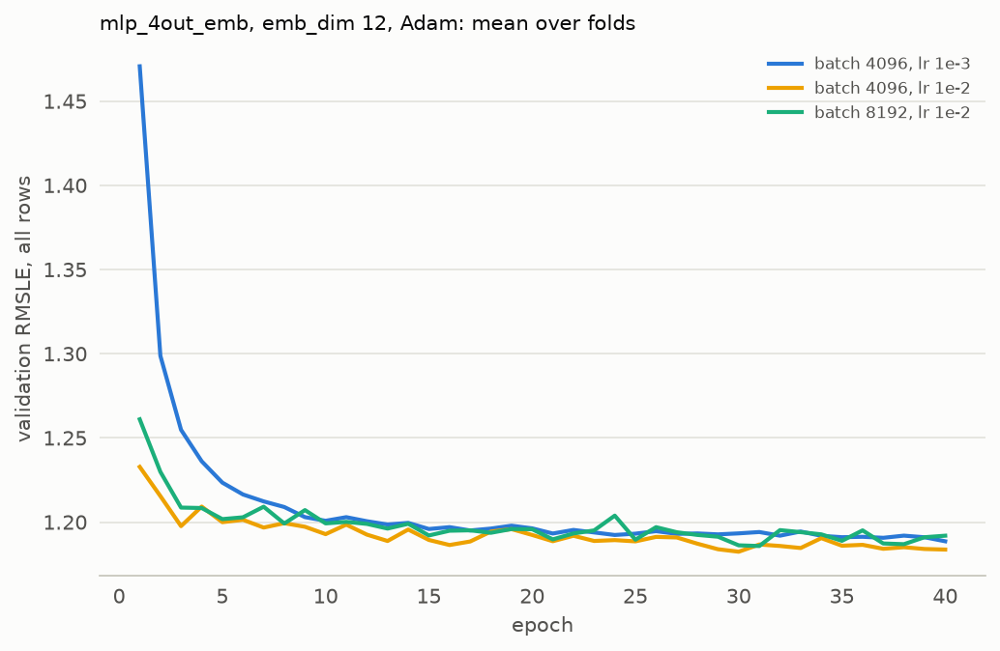
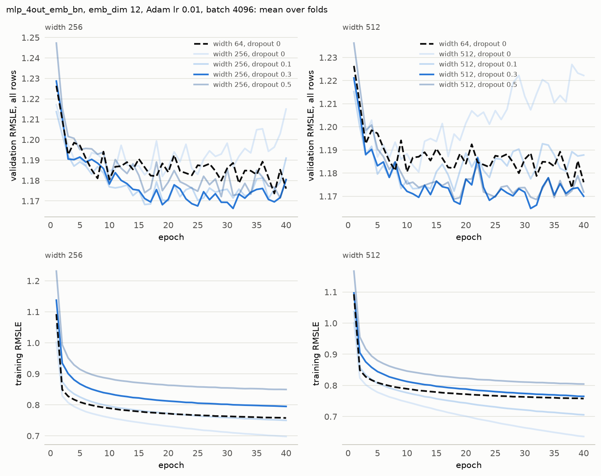
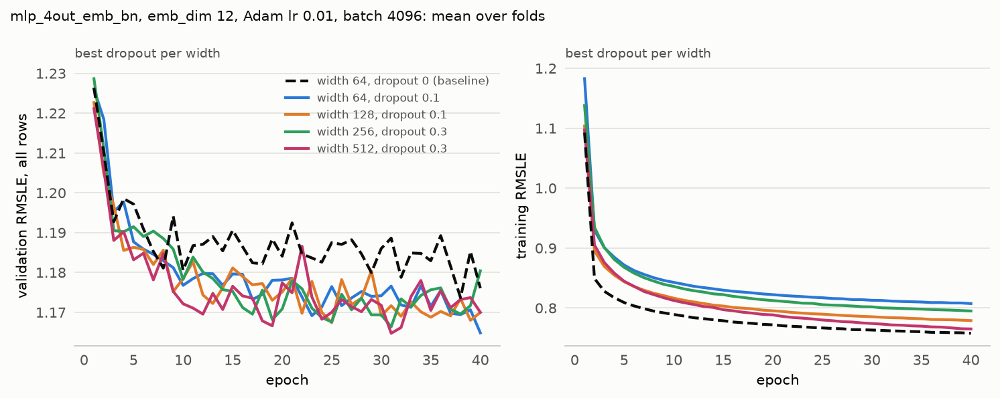
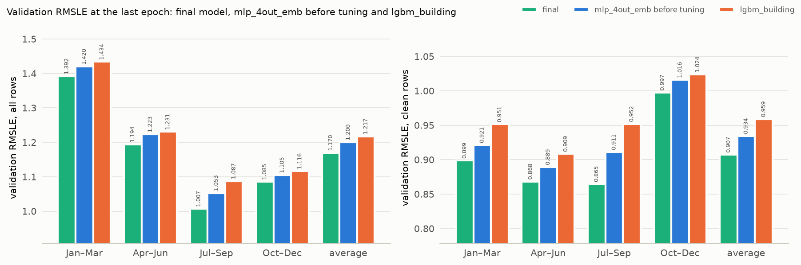

# MLP report

**Current model:** mlp_4out_emb with BatchNorm, 2 hidden layers of 64, dropout 0.1, emb_dim 12, Adam lr 1e-2 divided by 10 at epochs 20 and 30, batch 4096, fold-average RMSLE 1.167 on all rows and 0.907 on clean rows at the best epoch of 40, 1.169 averaged over epochs 36–40 (baseline lgbm_building 1.217).

MLP in PyTorch on the shared features from [ashrae/features.py](../ashrae/features.py). All runs share 2 hidden layers of 64, ReLU, 2M training / 500K validation rows per fold, anomalies dropped from training only, seed 0. exp01–exp03 train with Adam lr 1e-3, batch 4096 for 10 epochs; from exp04 on, runs train for 40 epochs and are scored at their best epoch.

Settings found so far:

- One output per meter type ([exp01](experiments/exp01_outputs.md))
- Building identity as a learned embedding ([exp02](experiments/exp02_building.md))
- Embedding size 12 ([exp03](experiments/exp03_emb_dim.md))
- Adam ([exp05](experiments/exp05_optimizers.md), [exp06](experiments/exp06_optimizers_large_batch.md))
- Batch 4096 at lr 1e-2 ([exp07](experiments/exp07_batch_size_best_lr.md), [exp08](experiments/exp08_batch_8192.md))
- BatchNorm in the hidden layers ([exp09](experiments/exp09_batch_norm.md))
- Width 64 ([exp10](experiments/exp10_width.md), [exp11](experiments/exp11_width_lr.md), [exp15](experiments/exp15_small_width_dropout.md))
- No weight decay ([exp12](experiments/exp12_width_weight_decay.md), [exp13](experiments/exp13_width_no_bn_weight_decay.md))
- Dropout 0.1 after each hidden layer ([exp14](experiments/exp14_width_dropout.md), [exp15](experiments/exp15_small_width_dropout.md))
- 2 hidden layers ([exp16](experiments/exp16_depth.md))
- Step decay of the learning rate ([exp17](experiments/exp17_lr_schedule.md))

## Outputs

One output per meter type lowers RMSLE by 0.013 (1.559 to 1.546), on all 4 folds and at every epoch, most on hot water (2.009 to 1.972). The gain is close to the 0.01 threshold and both are far behind the baseline. mlp_4out is kept for tuning. [exp01](experiments/exp01_outputs.md)

## Building

Building identity matters as much as for the baseline: the series mean cuts RMSLE from 1.546 to 1.251, a learned 16-number embedding to 1.200. Only mlp_4out_emb beats lgbm_building (1.217), on all 4 folds but by 0.017 from one seed. The embedding is kept. [exp02](experiments/exp02_building.md)

## Embedding size

RMSLE falls with size from 1.243 (2) to 1.200 (16), but from 8 upward every size is within 0.01 of the best. 12 (1.203) is kept as the smaller model comfortably within the threshold. [exp03](experiments/exp03_emb_dim.md)

---

**Remark:** The experiments above all used a fixed 10 epochs. Early stopping would not change any of their decisions: validation is still improving at epoch 10, so no run would stop early, and the curves being compared never cross.

## Optimizers

Adam beats Momentum and Nesterov in every fold: 1.176 against 1.196 at batch 4096, and by about 0.03 at batch 8192 and 16384. Adam is kept. [exp05](experiments/exp05_optimizers.md), [exp06](experiments/exp06_optimizers_large_batch.md)

## Batch size

At lr 1e-2, batch 4096 scores best (1.176, against 1.180 for 8192 and 1.182 for 16384) and beats the previous lr 1e-3 by 0.010 in every fold. Batch 8192 is 35% faster but slightly worse, so batch 4096 at lr 1e-2 is kept. [exp07](experiments/exp07_batch_size_best_lr.md), [exp08](experiments/exp08_batch_8192.md)

## BatchNorm

At lr 1e-2, BatchNorm lowers RMSLE from 1.176 to 1.168, in every fold, but on clean rows only from 0.913 to 0.912. The gain is below the 0.01 threshold, but it is consistent: BatchNorm scores lower in 18 of 20 rate–fold pairs from lr 5e-3 to 4e-2. BatchNorm at lr 1e-2 is kept. [exp09](experiments/exp09_batch_norm.md)

## Width

No wider layer beats width 64 (1.168): 128 scores 1.170, 256 and 512 both 1.174. Wider networks overfit: width 512 peaks at epoch 12 instead of 35, then validation rises while training keeps falling. Lowering its rate to 3e-3 (1.175) only slows this. [exp10](experiments/exp10_width.md), [exp11](experiments/exp11_width_lr.md)

## Weight decay

AdamW weight decay does not stop the wider networks from overfitting. At widths 256 and 512, every decay from 0.01 to 1 scores at or above the 1.174 without it, and RMSLE rises with decay (1.175 to 1.210). BatchNorm undoes the scale of the hidden weights, so decay there barely acts. But without BatchNorm, decay 0.1 at width 512 is no better either (1.181 against 1.179): it holds training RMSLE at the level of width 64 while validation does not improve. No weight decay is kept. [exp12](experiments/exp12_width_weight_decay.md), [exp13](experiments/exp13_width_no_bn_weight_decay.md)

## Dropout

Dropout helps the wide networks: 0.3 lowers widths 256 and 512 from 1.174 to 1.163 and 1.159, in every fold. In the end they still tie width 64 with dropout 0.1 (1.162), so width 64 with dropout 0.1 is kept. [exp14](experiments/exp14_width_dropout.md), [exp15](experiments/exp15_small_width_dropout.md)

## Depth

No depth beats 2 hidden layers (1.162): 3 layers score 1.164, 4 layers 1.169 and 1 layer 1.179. 2 layers are kept. [exp16](experiments/exp16_depth.md)

## Learning-rate schedule

No schedule improves the score: averaged over epochs 36–40 all four are within 0.002 (1.169 to 1.170). Decay only removes noise, as the constant rate swings between 1.165 and 1.177. Step decay (lr divided by 10 at epochs 20 and 30) is kept because it settles soonest and needs no validation set. [exp17](experiments/exp17_lr_schedule.md)

## Final comparison

At the last epoch the final model scores 1.170, against 1.200 for mlp_4out_emb before tuning and 1.217 for lgbm_building, and beats both by more than 0.01 in all 4 folds. [exp18](experiments/exp18_final_comparison.md)

On Kaggle, all trained on 2M rows from all of 2016 with anomalies dropped ([submission_final.ipynb](notebooks/submissions/submission_final.ipynb), [submission_mlp.ipynb](notebooks/submissions/submission_mlp.ipynb), [submission_mlp_bn.ipynb](notebooks/submissions/submission_mlp_bn.ipynb), [baseline submission](../baseline/baseline_report.md#submission)):

| Submission | Local validation | Public | Private |
| --- | --- | --- | --- |
| lgbm_building | 1.217 | 1.110 | 1.318 |
| mlp_4out_emb before tuning | 1.200 | 1.109 | 1.315 |
| mlp_4out_emb before tuning, with BatchNorm | – | 1.106 | 1.314 |
| final mlp_4out_emb_bn | 1.170 | 1.086 | 1.323 |

## Is the model adequate

Tuning did not help much. The best model so far is the same as was used in first version of MLP HW 1 – mlp_4out_emb with batch norm. 

Thus, earlier conclusions about model and blend were accurate.
