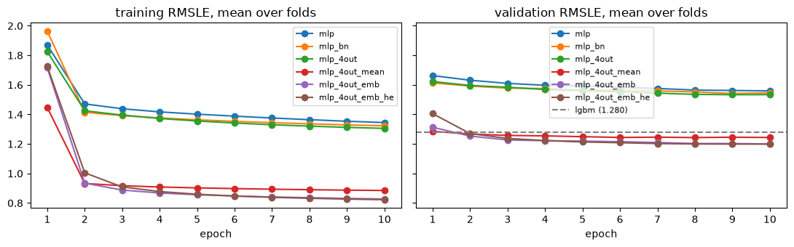
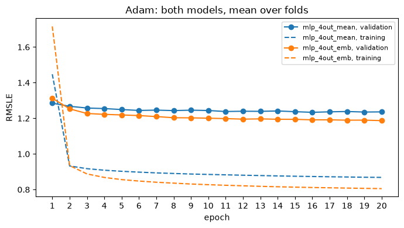
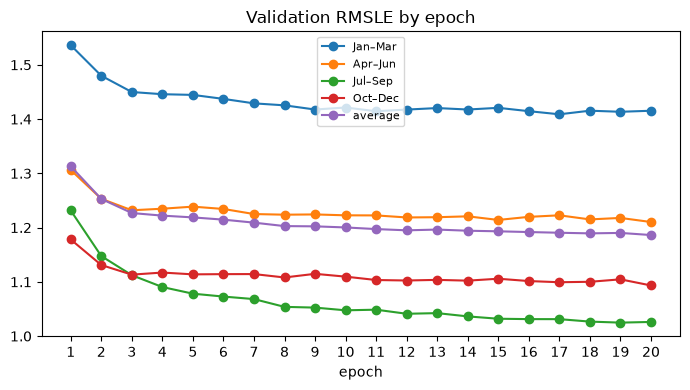
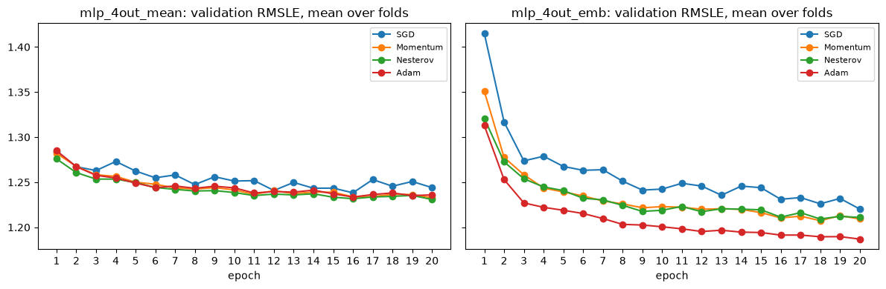
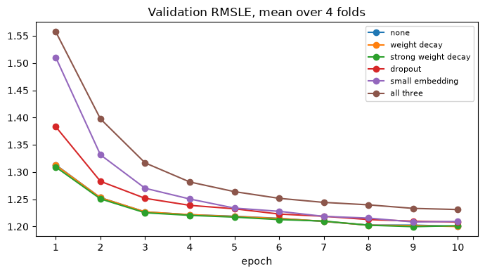
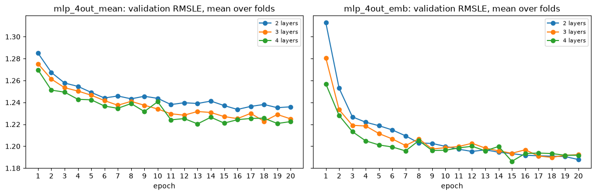

# Models

Notebooks: [mlp.ipynb](notebooks/mlp.ipynb), [layers_test.ipynb](notebooks/layers_test.ipynb), [epochs_test.ipynb](notebooks/epochs_test.ipynb), [optimizers_test.ipynb](notebooks/optimizers_test.ipynb), [regularization_test.ipynb](notebooks/regularization_test.ipynb).

The best model we found is an MLP with 4 outputs, one per meter type, and an embedding for each building.

All networks use one PyTorch Lightning module and log to MLflow ([mlp.ipynb, Frameworks](notebooks/mlp.ipynb#frameworks)). We added one change at a time, 10 epochs each ([mlp.ipynb, Results](notebooks/mlp.ipynb)):

| Model | Change | RMSLE, all rows | RMSLE, clean rows |
| --- | --- | --- | --- |
| mlp | 2 hidden layers of 64, ReLU, Adam | 1.559 | 1.380 |
| mlp_bn | + BatchNorm | 1.546 | 1.368 |
| mlp_4out | + one output per meter type | 1.534 | 1.350 |
| mlp_4out_mean | + series mean input | 1.244 | 0.994 |
| mlp_4out_emb | + building embedding instead | 1.200 | 0.938 |
| lgbm | LightGBM, untuned, same features ([baseline](../baseline/baseline_report.md)) | 1.280 | 1.045 |



What we learned:

- Knowing the building matters most: 1.534 → 1.244 with the series mean, 1.200 with the embedding. Both beat LightGBM in every fold. Similar buildings can use orders of magnitude different energy.
- BatchNorm and per-meter outputs help a little (~0.01 each, close to seed noise).
- The embedding beats the series mean in every season, mostly on heating and cooling. It can learn how a building reacts to weather, the mean only gives its average level ([mean_vs_embedding.ipynb](../validation/notebooks/mean_vs_embedding.ipynb)).
- Adam was best in every fold, ahead of Momentum, Nesterov and plain SGD. Each optimizer got one usual learning rate, not tuned, so this compares optimizers, not their best settings ([optimizers_test.ipynb](notebooks/optimizers_test.ipynb)).
- 20 epochs: validation still improves at the end (1.219 at 5, 1.200 at 10, 1.186 at 20) ([epochs_test.ipynb](notebooks/epochs_test.ipynb)).
- 2 hidden layers: 3 and 4 don't help ([layers_test.ipynb](notebooks/layers_test.ipynb)).
- Hot water is the hardest meter: 1.57 vs 0.95 for electricity.

## Chosen hyperparameters

| Setting | mlp_4out_emb | Where it was chosen |
| --- | --- | --- |
| Hidden layers | 2 x 64, Linear → BatchNorm → ReLU (no other sizes tried) | [mlp.ipynb](notebooks/mlp.ipynb), [layers_test.ipynb](notebooks/layers_test.ipynb) |
| Outputs | 4, one per meter type | [mlp.ipynb](notebooks/mlp.ipynb) |
| Building embedding | 16 numbers per building (4 was worse) | [regularization_test.ipynb](notebooks/regularization_test.ipynb) |
| Optimizer | Adam (AdamW, weight decay 0), learning rate 1e-3, default betas; learning rate not tuned, no LR scheduler | [optimizers_test.ipynb](notebooks/optimizers_test.ipynb) |
| Batch size | 4096, not tuned | [ashrae/modeling.py](../ashrae/modeling.py) |
| Epochs | 20 | [epochs_test.ipynb](notebooks/epochs_test.ipynb) |
| Dropout, weight decay | none | [regularization_test.ipynb](notebooks/regularization_test.ipynb) |
| Initialization | PyTorch default (He was the same) | [mlp.ipynb](notebooks/mlp.ipynb#follow-up) |
| Loss | MSE on `log1p(meter_reading)` | [EDA §8](../eda/notebooks/EDA.ipynb#metric) |
| Input scaling | StandardScaler fitted on training rows | [ashrae/modeling.py](../ashrae/modeling.py) |
| Training rows | 2M per fold (4M didn't help) | [ensemble.ipynb](../ensemble/notebooks/ensemble.ipynb) |
| Seed | 0 | [ashrae/tracking.py](../ashrae/tracking.py) |

LightGBM settings are in the [baseline report](../baseline/baseline_report.md#setup).

## Optimization curves

With Adam and 20 epochs, validation drops fast for 3 epochs, then slowly. Training stays ~0.4 lower the whole time ([optimizers_test.ipynb](notebooks/optimizers_test.ipynb)):



The fold average is still improving at epoch 20, so early stopping had nothing to stop ([epochs_test.ipynb](notebooks/epochs_test.ipynb)):



Optimizer, regularization and depth comparisons:







## Training logs (PyTorch Lightning + MLflow)

Every network is trained by one `LightningModule`, `EnergyModel` ([ashrae/modeling.py](../ashrae/modeling.py)), and logged with `MLFlowLogger` ([ashrae/tracking.py](../ashrae/tracking.py)). Each run saves its settings and training / validation RMSLE per epoch; model comparisons also log RMSLE per meter type and on clean rows. All 260 runs are in [mlflow.db](../mlflow.db):

| MLflow experiment | Runs | What it compares |
| --- | --- | --- |
| ashrae-mlp | 99 | model build-up, He initialization, LightGBM; 41 runs are from the old Handout validation |
| ashrae-optimizers | 56 | SGD, Momentum, Nesterov, Adam |
| ashrae-regularization | 44 | weight decay, dropout, smaller embedding |
| ashrae-layers | 24 | 2, 3, 4 hidden layers |
| ashrae-mean-vs-emb | 16 | series mean vs embedding |
| ashrae-ensemble | 8 | MLP runs for the blend, 2M and 4M rows |
| ashrae-season-validation | 6 | train vs validation per season |
| ashrae-epochs | 4 | 20 epochs per fold |
| ashrae-submission | 3 | final MLP and LightGBM, LightGBM baseline submission |

To browse them, run this from the homework root folder and open <http://127.0.0.1:5000>:

```bash
poetry run mlflow ui --backend-store-uri sqlite:///mlflow.db
```

## Is the model adequate?

mlp_4out_emb is adequate for the inputs it has. It beats LightGBM in every fold and every meter type. It isn't overfitting (regularization only hurts) and isn't short of capacity or data (more layers and 2x rows change nothing). Most of what's left is anomaly rows and seasons. To do better it needs new inputs, like lagged and rolling weather, not a bigger network ([ensemble.ipynb, Recommendations](../ensemble/notebooks/ensemble.ipynb)).
