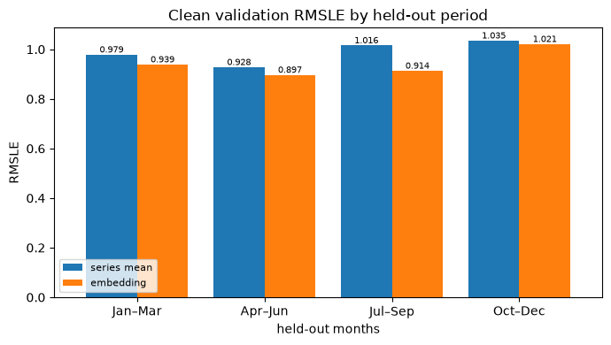

# Experiment 03: Series mean vs building embedding

## Request

Not recorded; converted from `validation/notebooks/mean_vs_embedding.ipynb` (runs of 2026-09-27).

## Question

Is mlp_4out_mean_bn's fold-average clean validation RMSLE at most 0.01 above mlp_4out_emb_bn's, without being more than 0.01 worse on most folds?

## Plan

On the single Oct–Dec split the two building-aware models almost tied (1.122 vs 1.111), and the mean model is much simpler. The rule above was fixed before running. Train both on the 4 seasonal folds with the same rows and seed and compare clean-row RMSLE, with all rows and per-meter scores alongside.

## Setup

- **Notebook:** [exp03_mean_vs_embedding.ipynb](../notebooks/experiments/exp03_mean_vs_embedding.ipynb)
- **Tracking:** MLflow `ashrae-validation-mean_vs_embedding`, session `2026-09-27 13:26:10`, 8 runs named `<model> | <fold>`, tag `notebook = exp03_mean_vs_embedding`
- **What changes:** how the network knows the building: the series mean as one extra input (mean, 6,916 parameters) or a learned 16-number vector per building (emb, 31,060 parameters)
- **What stays fixed:** mlp_4out_bn (mlp_4out from [mlp exp01_outputs](../../mlp/experiments/exp01_outputs.md) with BatchNorm): 2 hidden layers of 64, BatchNorm, ReLU, one output per meter type; Adam, lr 1e-3, batch 4096, 10 epochs; 2M training / 500K validation rows per fold; seed 0
- **Metric:** validation RMSLE on clean rows per fold and averaged; on all rows; on clean rows per meter type

## Results

| Meter | emb | mean | mean minus emb |
| --- | --- | --- | --- |
| electricity | 0.421 | 0.430 | 0.009 |
| chilledwater | 1.296 | 1.374 | 0.078 |
| steam | 1.405 | 1.495 | 0.090 |
| hotwater | 1.570 | 1.597 | 0.027 |

RMSLE on clean validation rows (500K per fold minus anomalies), the table averaged over folds. Fold average: clean 0.943 (emb) vs 0.990 (mean), all rows 1.203 vs 1.241.

## AI Summary

No: the embedding model is better on every fold, by 0.047 on the clean fold average (almost 5 times the margin) and by 0.014 to 0.102 per fold, so mlp_4out_emb_bn stays. The gain is in the seasonal meters (chilled water 0.078, steam 0.090, electricity 0.009), where the embedding can learn how a building reacts to weather.

## Conclusion

[human]
