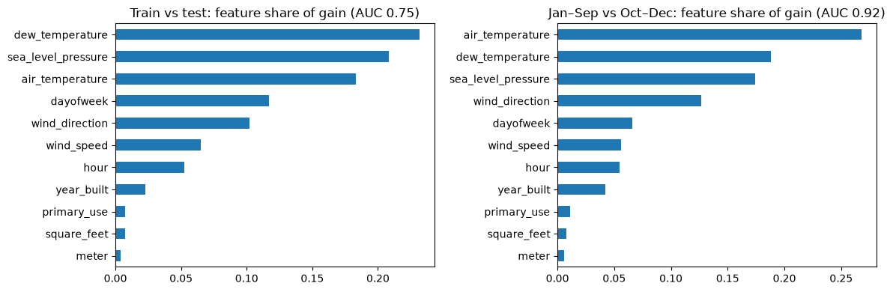
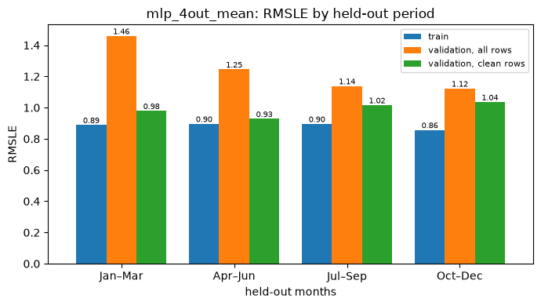

# Validation Strategy

Experiments, one card each: [exp01_adversarial](experiments/exp01_adversarial.md), [exp02_seasons](experiments/exp02_seasons.md), [exp03_mean_vs_embedding](experiments/exp03_mean_vs_embedding.md).

## Adversarial validation

Adversarial validation found no feature to drop. LightGBM tells 2016 from 2017–2018 with AUC 0.75, but only 0.52 without weather, and each weather feature alone gives 0.51–0.54 ([exp01_adversarial](experiments/exp01_adversarial.md)). Together the weather features act like a timestamp, so this is not a real leak.

## Handout approach (failed)

At first we trained on Jan–Sep and validated on Oct–Dec ([exp01_outputs](../mlp/experiments/exp01_outputs.md)). Adversarial validation then showed the two parts are told apart with AUC 0.92, all from weather (right panel above, [exp01_adversarial](experiments/exp01_adversarial.md)).

## Seasonal 4-Fold

After that we used four folds. Each holds out one 3-month block of 2016 and trains on the other nine months, with 2M training and 500K validation rows per fold. We compare settings by the mean over folds ([exp01_adversarial](experiments/exp01_adversarial.md); folds in [ashrae/config.py](../ashrae/config.py#L13)). Training on months after the validation block is fine here, since the test is a later year with known weather.

Each fold is scored on all rows (as Kaggle does) and on clean rows ([exp02_seasons](experiments/exp02_seasons.md)). This explained why seasons differ so much:

- on all rows, validation goes from 1.12 (Oct–Dec) to 1.46 (Jan–Mar), in the same order as the share of anomalies (1.1% → 6.1%)
- on clean rows it's only 0.93–1.04
- for the final MLP, of the 0.37 gap between training and validation, 0.26 comes from anomaly rows in validation ([exp03_mean_vs_embedding](experiments/exp03_mean_vs_embedding.md))

## Expected correlation with the leaderboard

The test set is 2017–2018 for the same buildings, with weather given.

Why it should correlate well:

- the four folds cover every season, like the two test years
- train and test differ only in weather: without weather the adversarial AUC is 0.52
- we score on all rows, anomalies included, like Kaggle

Why it might not:

- broken meters decide a lot of the score, and we can't see how many outages 2017–2018 has
- buildings change over 1–2 years (renovations, new equipment), and the 2016 embedding can't know that
- our folds are inside 2016, while the test years are all after it

How it turned out on Kaggle: [Leaderboard results](../ensemble/ensemble_report.md#leaderboard-results).
